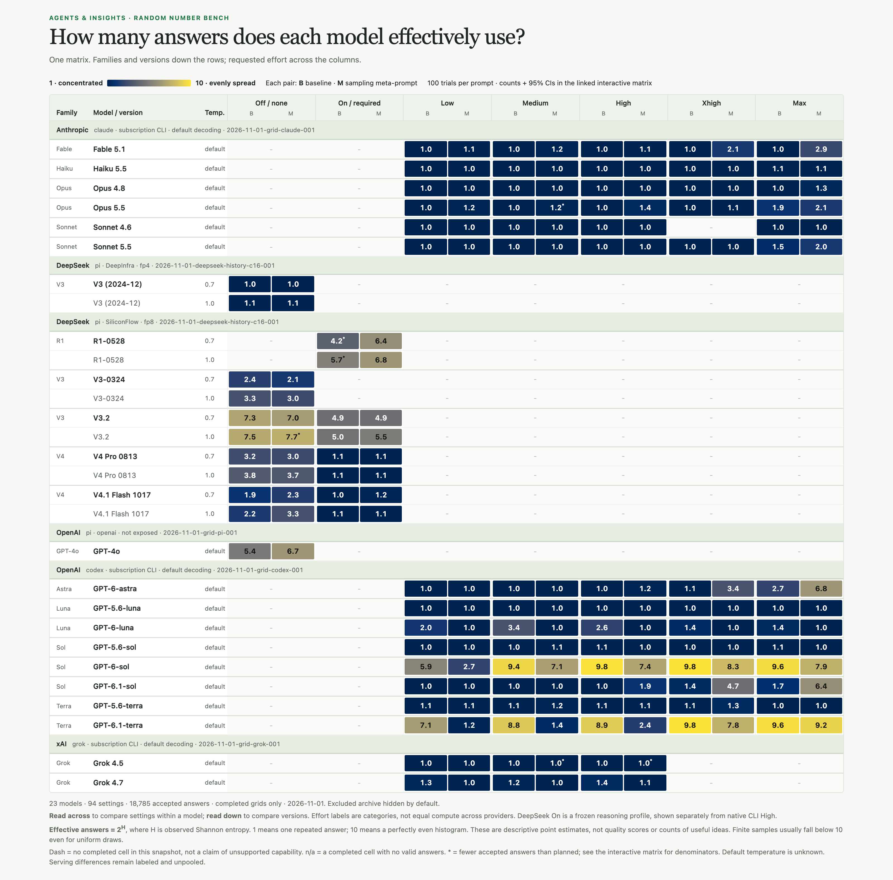

# Recorded results

<!-- Generated by bench.py report. Do not edit manually. -->

Completed-grid snapshot: effective answer count from 1 (concentrated) to 10 (evenly spread). [Full-resolution image](reports/comparison.png) · [Interactive matrix](reports/comparison.html) (download and open) · [Scope and interpretation](VISUALIZATION.md). Historical rounds and excluded settings remain in the tables below.

## Model and effort grids

Each model/effort/prompt cell remains separate. Confidence intervals describe the answer proportions among accepted trials.

## Grid 2026-11-01-deepseek-history-c16-001

<!-- Generated by grid_results.report_lines. Do not edit manually. -->

Frozen pi service grid via provider openrouter: 22 model/effort cells x 2 prompts x 100 randomized complete blocks = 4400 planned logical trials, all under one shared bounded concurrency controller. State: complete.
Recorded 4427 physical attempts for 4400 attempted logical trials: 3993 accepted, 434 attempts excluded (407 invalid responses, 27 operational).
Runner pi version `1.3.0`, evidence level pi_http_request. Requested model and effort are shown per row; reported model metadata is checked where the runner exposes it.
Evidence: [manifest, frozen schedule and provenance](results/2026-11-01-deepseek-history-c16-001/manifest.json), [attempts](results/2026-11-01-deepseek-history-c16-001/attempts.jsonl), [summary](results/2026-11-01-deepseek-history-c16-001/summary.json).

### Cell summary

| Model | Mode | Requested effort | Temperature | Release | Upstream / precision | Stratum | Prompt | Accepted / planned | Invalid responses | Operational exclusions | TV | Reported metadata (USD) |
| --- | --- | --- | --- | --- | --- | --- | --- | ---: | ---: | ---: | ---: | ---: |
| deepseek/deepseek-chat | non_reasoning | off | 0.7 | 2024-12 | DeepInfra / fp4 | historical_anchor | baseline | 100 / 100 | 0 | 0 | 0.900 | 0.0011 |
| deepseek/deepseek-chat | non_reasoning | off | 0.7 | 2024-12 | DeepInfra / fp4 | historical_anchor | meta | 100 / 100 | 0 | 0 | 0.900 | 0.0015 |
| deepseek/deepseek-chat | non_reasoning | off | 1 | 2024-12 | DeepInfra / fp4 | historical_anchor | baseline | 100 / 100 | 0 | 0 | 0.890 | 0.0011 |
| deepseek/deepseek-chat | non_reasoning | off | 1 | 2024-12 | DeepInfra / fp4 | historical_anchor | meta | 100 / 100 | 0 | 0 | 0.880 | 0.0015 |
| deepseek/deepseek-chat-v3-0324 | non_reasoning | off | 0.7 | 2025-03 | SiliconFlow / fp8 | matched_fp8 | baseline | 100 / 100 | 0 | 0 | 0.680 | 0.0010 |
| deepseek/deepseek-chat-v3-0324 | non_reasoning | off | 0.7 | 2025-03 | SiliconFlow / fp8 | matched_fp8 | meta | 100 / 100 | 0 | 0 | 0.690 | 0.0014 |
| deepseek/deepseek-chat-v3-0324 | non_reasoning | off | 1 | 2025-03 | SiliconFlow / fp8 | matched_fp8 | baseline | 100 / 100 | 0 | 0 | 0.630 | 0.0010 |
| deepseek/deepseek-chat-v3-0324 | non_reasoning | off | 1 | 2025-03 | SiliconFlow / fp8 | matched_fp8 | meta | 100 / 100 | 0 | 0 | 0.590 | 0.0014 |
| deepseek/deepseek-r1-0528 | required | high | 0.7 | 2025-05 | SiliconFlow / fp8 | matched_fp8 | baseline | 98 / 100 | 2 | 8 | 0.578 | n/a |
| deepseek/deepseek-r1-0528 | required | high | 0.7 | 2025-05 | SiliconFlow / fp8 | matched_fp8 | meta | 100 / 100 | 0 | 5 | 0.380 | n/a |
| deepseek/deepseek-r1-0528 | required | high | 1 | 2025-05 | SiliconFlow / fp8 | matched_fp8 | baseline | 98 / 100 | 2 | 12 | 0.476 | n/a |
| deepseek/deepseek-r1-0528 | required | high | 1 | 2025-05 | SiliconFlow / fp8 | matched_fp8 | meta | 100 / 100 | 0 | 2 | 0.320 | n/a |
| deepseek/deepseek-chat-v3.1 | off | off | 0.7 | 2025-08 | SiliconFlow / fp8 | matched_fp8 | baseline | 100 / 100 | 0 | 0 | 0.690 | 0.0012 |
| deepseek/deepseek-chat-v3.1 | off | off | 0.7 | 2025-08 | SiliconFlow / fp8 | matched_fp8 | meta | 100 / 100 | 0 | 0 | 0.820 | 0.0017 |
| deepseek/deepseek-chat-v3.1 | off | off | 1 | 2025-08 | SiliconFlow / fp8 | matched_fp8 | baseline | 99 / 100 | 1 | 0 | 0.589 | 0.0012 |
| deepseek/deepseek-chat-v3.1 | off | off | 1 | 2025-08 | SiliconFlow / fp8 | matched_fp8 | meta | 100 / 100 | 0 | 0 | 0.630 | 0.0017 |
| deepseek/deepseek-chat-v3.1 | on | high | 0.7 | 2025-08 | SiliconFlow / fp8 | matched_fp8 | baseline | 0 / 100 | 100 | 0 | n/a | 0.0012 |
| deepseek/deepseek-chat-v3.1 | on | high | 0.7 | 2025-08 | SiliconFlow / fp8 | matched_fp8 | meta | 0 / 100 | 100 | 0 | n/a | 0.0017 |
| deepseek/deepseek-chat-v3.1 | on | high | 1 | 2025-08 | SiliconFlow / fp8 | matched_fp8 | baseline | 0 / 100 | 100 | 0 | n/a | 0.0012 |
| deepseek/deepseek-chat-v3.1 | on | high | 1 | 2025-08 | SiliconFlow / fp8 | matched_fp8 | meta | 0 / 100 | 100 | 0 | n/a | 0.0017 |
| deepseek/deepseek-v3.2 | off | off | 0.7 | 2025-12 | SiliconFlow / fp8 | matched_fp8 | baseline | 100 / 100 | 0 | 0 | 0.310 | 0.0010 |
| deepseek/deepseek-v3.2 | off | off | 0.7 | 2025-12 | SiliconFlow / fp8 | matched_fp8 | meta | 100 / 100 | 0 | 0 | 0.320 | 0.0015 |
| deepseek/deepseek-v3.2 | off | off | 1 | 2025-12 | SiliconFlow / fp8 | matched_fp8 | baseline | 100 / 100 | 0 | 0 | 0.280 | 0.0010 |
| deepseek/deepseek-v3.2 | off | off | 1 | 2025-12 | SiliconFlow / fp8 | matched_fp8 | meta | 98 / 100 | 2 | 0 | 0.267 | 0.0015 |
| deepseek/deepseek-v3.2 | on | high | 0.7 | 2025-12 | SiliconFlow / fp8 | matched_fp8 | baseline | 100 / 100 | 0 | 0 | 0.400 | 0.0324 |
| deepseek/deepseek-v3.2 | on | high | 0.7 | 2025-12 | SiliconFlow / fp8 | matched_fp8 | meta | 100 / 100 | 0 | 0 | 0.490 | 0.0440 |
| deepseek/deepseek-v3.2 | on | high | 1 | 2025-12 | SiliconFlow / fp8 | matched_fp8 | baseline | 100 / 100 | 0 | 0 | 0.430 | 0.0358 |
| deepseek/deepseek-v3.2 | on | high | 1 | 2025-12 | SiliconFlow / fp8 | matched_fp8 | meta | 100 / 100 | 0 | 0 | 0.440 | 0.0436 |
| deepseek/deepseek-v4-pro-0813 | off | off | 0.7 | 2026-08 | SiliconFlow / fp8 | matched_fp8 | baseline | 100 / 100 | 0 | 0 | 0.670 | 0.0053 |
| deepseek/deepseek-v4-pro-0813 | off | off | 0.7 | 2026-08 | SiliconFlow / fp8 | matched_fp8 | meta | 100 / 100 | 0 | 0 | 0.690 | 0.0077 |
| deepseek/deepseek-v4-pro-0813 | off | off | 1 | 2026-08 | SiliconFlow / fp8 | matched_fp8 | baseline | 100 / 100 | 0 | 0 | 0.600 | 0.0053 |
| deepseek/deepseek-v4-pro-0813 | off | off | 1 | 2026-08 | SiliconFlow / fp8 | matched_fp8 | meta | 100 / 100 | 0 | 0 | 0.600 | 0.0077 |
| deepseek/deepseek-v4-pro-0813 | on | high | 0.7 | 2026-08 | SiliconFlow / fp8 | matched_fp8 | baseline | 100 / 100 | 0 | 0 | 0.890 | 0.0301 |
| deepseek/deepseek-v4-pro-0813 | on | high | 0.7 | 2026-08 | SiliconFlow / fp8 | matched_fp8 | meta | 100 / 100 | 0 | 0 | 0.890 | 0.0306 |
| deepseek/deepseek-v4-pro-0813 | on | high | 1 | 2026-08 | SiliconFlow / fp8 | matched_fp8 | baseline | 100 / 100 | 0 | 0 | 0.890 | 0.0301 |
| deepseek/deepseek-v4-pro-0813 | on | high | 1 | 2026-08 | SiliconFlow / fp8 | matched_fp8 | meta | 100 / 100 | 0 | 0 | 0.890 | 0.0301 |
| deepseek/deepseek-v4.1-flash-1017 | off | off | 0.7 | 2026-10 | SiliconFlow / fp8 | matched_fp8 | baseline | 100 / 100 | 0 | 0 | 0.730 | 0.0013 |
| deepseek/deepseek-v4.1-flash-1017 | off | off | 0.7 | 2026-10 | SiliconFlow / fp8 | matched_fp8 | meta | 100 / 100 | 0 | 0 | 0.730 | 0.0018 |
| deepseek/deepseek-v4.1-flash-1017 | off | off | 1 | 2026-10 | SiliconFlow / fp8 | matched_fp8 | baseline | 100 / 100 | 0 | 0 | 0.720 | 0.0013 |
| deepseek/deepseek-v4.1-flash-1017 | off | off | 1 | 2026-10 | SiliconFlow / fp8 | matched_fp8 | meta | 100 / 100 | 0 | 0 | 0.630 | 0.0018 |
| deepseek/deepseek-v4.1-flash-1017 | on | high | 0.7 | 2026-10 | SiliconFlow / fp8 | matched_fp8 | baseline | 100 / 100 | 0 | 0 | 0.900 | 0.0051 |
| deepseek/deepseek-v4.1-flash-1017 | on | high | 0.7 | 2026-10 | SiliconFlow / fp8 | matched_fp8 | meta | 100 / 100 | 0 | 0 | 0.860 | 0.0060 |
| deepseek/deepseek-v4.1-flash-1017 | on | high | 1 | 2026-10 | SiliconFlow / fp8 | matched_fp8 | baseline | 100 / 100 | 0 | 0 | 0.890 | 0.0052 |
| deepseek/deepseek-v4.1-flash-1017 | on | high | 1 | 2026-10 | SiliconFlow / fp8 | matched_fp8 | meta | 100 / 100 | 0 | 0 | 0.880 | 0.0063 |

### Answer counts with 95% Wilson intervals

Each entry is count [low, high] for the proportion of accepted answers in that cell and prompt.

| Model | Mode | Requested effort | Temperature | Release | Upstream / precision | Stratum | Prompt | n | 1 | 2 | 3 | 4 | 5 | 6 | 7 | 8 | 9 | 10 |
| --- | --- | --- | --- | --- | --- | --- | --- | ---: | ---: | ---: | ---: | ---: | ---: | ---: | ---: | ---: | ---: | ---: |
| deepseek/deepseek-chat | non_reasoning | off | 0.7 | 2024-12 | DeepInfra / fp4 | historical_anchor | baseline | 100 | 0 [0.000, 0.037] | 0 [0.000, 0.037] | 0 [0.000, 0.037] | 0 [0.000, 0.037] | 0 [0.000, 0.037] | 0 [0.000, 0.037] | 100 [0.963, 1.000] | 0 [0.000, 0.037] | 0 [0.000, 0.037] | 0 [0.000, 0.037] |
| deepseek/deepseek-chat | non_reasoning | off | 0.7 | 2024-12 | DeepInfra / fp4 | historical_anchor | meta | 100 | 0 [0.000, 0.037] | 0 [0.000, 0.037] | 0 [0.000, 0.037] | 0 [0.000, 0.037] | 0 [0.000, 0.037] | 0 [0.000, 0.037] | 100 [0.963, 1.000] | 0 [0.000, 0.037] | 0 [0.000, 0.037] | 0 [0.000, 0.037] |
| deepseek/deepseek-chat | non_reasoning | off | 1 | 2024-12 | DeepInfra / fp4 | historical_anchor | baseline | 100 | 0 [0.000, 0.037] | 0 [0.000, 0.037] | 0 [0.000, 0.037] | 0 [0.000, 0.037] | 1 [0.002, 0.054] | 0 [0.000, 0.037] | 99 [0.946, 0.998] | 0 [0.000, 0.037] | 0 [0.000, 0.037] | 0 [0.000, 0.037] |
| deepseek/deepseek-chat | non_reasoning | off | 1 | 2024-12 | DeepInfra / fp4 | historical_anchor | meta | 100 | 0 [0.000, 0.037] | 0 [0.000, 0.037] | 0 [0.000, 0.037] | 0 [0.000, 0.037] | 0 [0.000, 0.037] | 1 [0.002, 0.054] | 98 [0.930, 0.994] | 1 [0.002, 0.054] | 0 [0.000, 0.037] | 0 [0.000, 0.037] |
| deepseek/deepseek-chat-v3-0324 | non_reasoning | off | 0.7 | 2025-03 | SiliconFlow / fp8 | matched_fp8 | baseline | 100 | 0 [0.000, 0.037] | 0 [0.000, 0.037] | 0 [0.000, 0.037] | 1 [0.002, 0.054] | 16 [0.101, 0.244] | 12 [0.070, 0.198] | 70 [0.604, 0.781] | 1 [0.002, 0.054] | 0 [0.000, 0.037] | 0 [0.000, 0.037] |
| deepseek/deepseek-chat-v3-0324 | non_reasoning | off | 0.7 | 2025-03 | SiliconFlow / fp8 | matched_fp8 | meta | 100 | 0 [0.000, 0.037] | 0 [0.000, 0.037] | 0 [0.000, 0.037] | 6 [0.028, 0.125] | 8 [0.041, 0.150] | 7 [0.034, 0.137] | 79 [0.700, 0.858] | 0 [0.000, 0.037] | 0 [0.000, 0.037] | 0 [0.000, 0.037] |
| deepseek/deepseek-chat-v3-0324 | non_reasoning | off | 1 | 2025-03 | SiliconFlow / fp8 | matched_fp8 | baseline | 100 | 0 [0.000, 0.037] | 0 [0.000, 0.037] | 0 [0.000, 0.037] | 4 [0.016, 0.098] | 26 [0.184, 0.354] | 15 [0.093, 0.233] | 52 [0.423, 0.615] | 3 [0.010, 0.085] | 0 [0.000, 0.037] | 0 [0.000, 0.037] |
| deepseek/deepseek-chat-v3-0324 | non_reasoning | off | 1 | 2025-03 | SiliconFlow / fp8 | matched_fp8 | meta | 100 | 0 [0.000, 0.037] | 0 [0.000, 0.037] | 1 [0.002, 0.054] | 11 [0.063, 0.186] | 12 [0.070, 0.198] | 7 [0.034, 0.137] | 66 [0.563, 0.745] | 3 [0.010, 0.085] | 0 [0.000, 0.037] | 0 [0.000, 0.037] |
| deepseek/deepseek-r1-0528 | required | high | 0.7 | 2025-05 | SiliconFlow / fp8 | matched_fp8 | baseline | 98 | 0 [0.000, 0.038] | 0 [0.000, 0.038] | 1 [0.002, 0.056] | 0 [0.000, 0.038] | 5 [0.022, 0.114] | 5 [0.022, 0.114] | 30 [0.224, 0.403] | 39 [0.307, 0.497] | 17 [0.111, 0.260] | 1 [0.002, 0.056] |
| deepseek/deepseek-r1-0528 | required | high | 0.7 | 2025-05 | SiliconFlow / fp8 | matched_fp8 | meta | 100 | 1 [0.002, 0.054] | 3 [0.010, 0.085] | 4 [0.016, 0.098] | 4 [0.016, 0.098] | 8 [0.041, 0.150] | 2 [0.006, 0.070] | 38 [0.291, 0.478] | 15 [0.093, 0.233] | 12 [0.070, 0.198] | 13 [0.078, 0.210] |
| deepseek/deepseek-r1-0528 | required | high | 1 | 2025-05 | SiliconFlow / fp8 | matched_fp8 | baseline | 98 | 0 [0.000, 0.038] | 2 [0.006, 0.071] | 2 [0.006, 0.071] | 3 [0.010, 0.086] | 5 [0.022, 0.114] | 8 [0.042, 0.153] | 27 [0.197, 0.371] | 23 [0.162, 0.328] | 26 [0.188, 0.360] | 2 [0.006, 0.071] |
| deepseek/deepseek-r1-0528 | required | high | 1 | 2025-05 | SiliconFlow / fp8 | matched_fp8 | meta | 100 | 1 [0.002, 0.054] | 3 [0.010, 0.085] | 5 [0.022, 0.112] | 9 [0.048, 0.162] | 11 [0.063, 0.186] | 6 [0.028, 0.125] | 40 [0.309, 0.498] | 11 [0.063, 0.186] | 7 [0.034, 0.137] | 7 [0.034, 0.137] |
| deepseek/deepseek-chat-v3.1 | off | off | 0.7 | 2025-08 | SiliconFlow / fp8 | matched_fp8 | baseline | 100 | 0 [0.000, 0.037] | 0 [0.000, 0.037] | 2 [0.006, 0.070] | 3 [0.010, 0.085] | 0 [0.000, 0.037] | 3 [0.010, 0.085] | 79 [0.700, 0.858] | 6 [0.028, 0.125] | 7 [0.034, 0.137] | 0 [0.000, 0.037] |
| deepseek/deepseek-chat-v3.1 | off | off | 0.7 | 2025-08 | SiliconFlow / fp8 | matched_fp8 | meta | 100 | 0 [0.000, 0.037] | 0 [0.000, 0.037] | 1 [0.002, 0.054] | 0 [0.000, 0.037] | 0 [0.000, 0.037] | 1 [0.002, 0.054] | 92 [0.850, 0.959] | 5 [0.022, 0.112] | 1 [0.002, 0.054] | 0 [0.000, 0.037] |
| deepseek/deepseek-chat-v3.1 | off | off | 1 | 2025-08 | SiliconFlow / fp8 | matched_fp8 | baseline | 99 | 0 [0.000, 0.037] | 1 [0.002, 0.055] | 2 [0.006, 0.071] | 2 [0.006, 0.071] | 2 [0.006, 0.071] | 4 [0.016, 0.099] | 55 [0.457, 0.650] | 18 [0.118, 0.269] | 15 [0.094, 0.235] | 0 [0.000, 0.037] |
| deepseek/deepseek-chat-v3.1 | off | off | 1 | 2025-08 | SiliconFlow / fp8 | matched_fp8 | meta | 100 | 0 [0.000, 0.037] | 0 [0.000, 0.037] | 5 [0.022, 0.112] | 5 [0.022, 0.112] | 0 [0.000, 0.037] | 6 [0.028, 0.125] | 73 [0.636, 0.807] | 7 [0.034, 0.137] | 4 [0.016, 0.098] | 0 [0.000, 0.037] |
| deepseek/deepseek-chat-v3.1 | on | high | 0.7 | 2025-08 | SiliconFlow / fp8 | matched_fp8 | baseline | 0 | 0 [n/a] | 0 [n/a] | 0 [n/a] | 0 [n/a] | 0 [n/a] | 0 [n/a] | 0 [n/a] | 0 [n/a] | 0 [n/a] | 0 [n/a] |
| deepseek/deepseek-chat-v3.1 | on | high | 0.7 | 2025-08 | SiliconFlow / fp8 | matched_fp8 | meta | 0 | 0 [n/a] | 0 [n/a] | 0 [n/a] | 0 [n/a] | 0 [n/a] | 0 [n/a] | 0 [n/a] | 0 [n/a] | 0 [n/a] | 0 [n/a] |
| deepseek/deepseek-chat-v3.1 | on | high | 1 | 2025-08 | SiliconFlow / fp8 | matched_fp8 | baseline | 0 | 0 [n/a] | 0 [n/a] | 0 [n/a] | 0 [n/a] | 0 [n/a] | 0 [n/a] | 0 [n/a] | 0 [n/a] | 0 [n/a] | 0 [n/a] |
| deepseek/deepseek-chat-v3.1 | on | high | 1 | 2025-08 | SiliconFlow / fp8 | matched_fp8 | meta | 0 | 0 [n/a] | 0 [n/a] | 0 [n/a] | 0 [n/a] | 0 [n/a] | 0 [n/a] | 0 [n/a] | 0 [n/a] | 0 [n/a] | 0 [n/a] |
| deepseek/deepseek-v3.2 | off | off | 0.7 | 2025-12 | SiliconFlow / fp8 | matched_fp8 | baseline | 100 | 0 [0.000, 0.037] | 4 [0.016, 0.098] | 9 [0.048, 0.162] | 5 [0.022, 0.112] | 11 [0.063, 0.186] | 14 [0.085, 0.221] | 27 [0.193, 0.364] | 19 [0.125, 0.278] | 8 [0.041, 0.150] | 3 [0.010, 0.085] |
| deepseek/deepseek-v3.2 | off | off | 0.7 | 2025-12 | SiliconFlow / fp8 | matched_fp8 | meta | 100 | 0 [0.000, 0.037] | 4 [0.016, 0.098] | 12 [0.070, 0.198] | 13 [0.078, 0.210] | 8 [0.041, 0.150] | 11 [0.063, 0.186] | 29 [0.210, 0.385] | 17 [0.109, 0.255] | 5 [0.022, 0.112] | 1 [0.002, 0.054] |
| deepseek/deepseek-v3.2 | off | off | 1 | 2025-12 | SiliconFlow / fp8 | matched_fp8 | baseline | 100 | 0 [0.000, 0.037] | 4 [0.016, 0.098] | 10 [0.055, 0.174] | 5 [0.022, 0.112] | 12 [0.070, 0.198] | 11 [0.063, 0.186] | 22 [0.150, 0.311] | 22 [0.150, 0.311] | 11 [0.063, 0.186] | 3 [0.010, 0.085] |
| deepseek/deepseek-v3.2 | off | off | 1 | 2025-12 | SiliconFlow / fp8 | matched_fp8 | meta | 98 | 2 [0.006, 0.071] | 5 [0.022, 0.114] | 10 [0.056, 0.178] | 10 [0.056, 0.178] | 14 [0.087, 0.226] | 20 [0.136, 0.294] | 19 [0.128, 0.283] | 12 [0.071, 0.202] | 6 [0.028, 0.127] | 0 [0.000, 0.038] |
| deepseek/deepseek-v3.2 | on | high | 0.7 | 2025-12 | SiliconFlow / fp8 | matched_fp8 | baseline | 100 | 0 [0.000, 0.037] | 1 [0.002, 0.054] | 9 [0.048, 0.162] | 10 [0.055, 0.174] | 11 [0.063, 0.186] | 13 [0.078, 0.210] | 46 [0.366, 0.557] | 10 [0.055, 0.174] | 0 [0.000, 0.037] | 0 [0.000, 0.037] |
| deepseek/deepseek-v3.2 | on | high | 0.7 | 2025-12 | SiliconFlow / fp8 | matched_fp8 | meta | 100 | 0 [0.000, 0.037] | 2 [0.006, 0.070] | 20 [0.133, 0.289] | 6 [0.028, 0.125] | 14 [0.085, 0.221] | 4 [0.016, 0.098] | 45 [0.356, 0.548] | 8 [0.041, 0.150] | 0 [0.000, 0.037] | 1 [0.002, 0.054] |
| deepseek/deepseek-v3.2 | on | high | 1 | 2025-12 | SiliconFlow / fp8 | matched_fp8 | baseline | 100 | 0 [0.000, 0.037] | 1 [0.002, 0.054] | 10 [0.055, 0.174] | 10 [0.055, 0.174] | 14 [0.085, 0.221] | 5 [0.022, 0.112] | 45 [0.356, 0.548] | 14 [0.085, 0.221] | 1 [0.002, 0.054] | 0 [0.000, 0.037] |
| deepseek/deepseek-v3.2 | on | high | 1 | 2025-12 | SiliconFlow / fp8 | matched_fp8 | meta | 100 | 0 [0.000, 0.037] | 0 [0.000, 0.037] | 24 [0.167, 0.332] | 10 [0.055, 0.174] | 17 [0.109, 0.255] | 4 [0.016, 0.098] | 32 [0.237, 0.417] | 11 [0.063, 0.186] | 1 [0.002, 0.054] | 1 [0.002, 0.054] |
| deepseek/deepseek-v4-pro-0813 | off | off | 0.7 | 2026-08 | SiliconFlow / fp8 | matched_fp8 | baseline | 100 | 0 [0.000, 0.037] | 0 [0.000, 0.037] | 1 [0.002, 0.054] | 0 [0.000, 0.037] | 49 [0.394, 0.587] | 19 [0.125, 0.278] | 29 [0.210, 0.385] | 2 [0.006, 0.070] | 0 [0.000, 0.037] | 0 [0.000, 0.037] |
| deepseek/deepseek-v4-pro-0813 | off | off | 0.7 | 2026-08 | SiliconFlow / fp8 | matched_fp8 | meta | 100 | 0 [0.000, 0.037] | 0 [0.000, 0.037] | 1 [0.002, 0.054] | 3 [0.010, 0.085] | 47 [0.375, 0.567] | 5 [0.022, 0.112] | 42 [0.328, 0.518] | 2 [0.006, 0.070] | 0 [0.000, 0.037] | 0 [0.000, 0.037] |
| deepseek/deepseek-v4-pro-0813 | off | off | 1 | 2026-08 | SiliconFlow / fp8 | matched_fp8 | baseline | 100 | 0 [0.000, 0.037] | 0 [0.000, 0.037] | 0 [0.000, 0.037] | 3 [0.010, 0.085] | 47 [0.375, 0.567] | 24 [0.167, 0.332] | 19 [0.125, 0.278] | 5 [0.022, 0.112] | 0 [0.000, 0.037] | 2 [0.006, 0.070] |
| deepseek/deepseek-v4-pro-0813 | off | off | 1 | 2026-08 | SiliconFlow / fp8 | matched_fp8 | meta | 100 | 0 [0.000, 0.037] | 0 [0.000, 0.037] | 4 [0.016, 0.098] | 3 [0.010, 0.085] | 40 [0.309, 0.498] | 9 [0.048, 0.162] | 40 [0.309, 0.498] | 4 [0.016, 0.098] | 0 [0.000, 0.037] | 0 [0.000, 0.037] |
| deepseek/deepseek-v4-pro-0813 | on | high | 0.7 | 2026-08 | SiliconFlow / fp8 | matched_fp8 | baseline | 100 | 0 [0.000, 0.037] | 0 [0.000, 0.037] | 0 [0.000, 0.037] | 1 [0.002, 0.054] | 0 [0.000, 0.037] | 0 [0.000, 0.037] | 99 [0.946, 0.998] | 0 [0.000, 0.037] | 0 [0.000, 0.037] | 0 [0.000, 0.037] |
| deepseek/deepseek-v4-pro-0813 | on | high | 0.7 | 2026-08 | SiliconFlow / fp8 | matched_fp8 | meta | 100 | 0 [0.000, 0.037] | 0 [0.000, 0.037] | 0 [0.000, 0.037] | 1 [0.002, 0.054] | 0 [0.000, 0.037] | 0 [0.000, 0.037] | 99 [0.946, 0.998] | 0 [0.000, 0.037] | 0 [0.000, 0.037] | 0 [0.000, 0.037] |
| deepseek/deepseek-v4-pro-0813 | on | high | 1 | 2026-08 | SiliconFlow / fp8 | matched_fp8 | baseline | 100 | 0 [0.000, 0.037] | 0 [0.000, 0.037] | 0 [0.000, 0.037] | 1 [0.002, 0.054] | 0 [0.000, 0.037] | 0 [0.000, 0.037] | 99 [0.946, 0.998] | 0 [0.000, 0.037] | 0 [0.000, 0.037] | 0 [0.000, 0.037] |
| deepseek/deepseek-v4-pro-0813 | on | high | 1 | 2026-08 | SiliconFlow / fp8 | matched_fp8 | meta | 100 | 0 [0.000, 0.037] | 0 [0.000, 0.037] | 0 [0.000, 0.037] | 1 [0.002, 0.054] | 0 [0.000, 0.037] | 0 [0.000, 0.037] | 99 [0.946, 0.998] | 0 [0.000, 0.037] | 0 [0.000, 0.037] | 0 [0.000, 0.037] |
| deepseek/deepseek-v4.1-flash-1017 | off | off | 0.7 | 2026-10 | SiliconFlow / fp8 | matched_fp8 | baseline | 100 | 0 [0.000, 0.037] | 0 [0.000, 0.037] | 6 [0.028, 0.125] | 12 [0.070, 0.198] | 0 [0.000, 0.037] | 0 [0.000, 0.037] | 81 [0.722, 0.875] | 1 [0.002, 0.054] | 0 [0.000, 0.037] | 0 [0.000, 0.037] |
| deepseek/deepseek-v4.1-flash-1017 | off | off | 0.7 | 2026-10 | SiliconFlow / fp8 | matched_fp8 | meta | 100 | 0 [0.000, 0.037] | 0 [0.000, 0.037] | 3 [0.010, 0.085] | 23 [0.158, 0.322] | 0 [0.000, 0.037] | 3 [0.010, 0.085] | 70 [0.604, 0.781] | 1 [0.002, 0.054] | 0 [0.000, 0.037] | 0 [0.000, 0.037] |
| deepseek/deepseek-v4.1-flash-1017 | off | off | 1 | 2026-10 | SiliconFlow / fp8 | matched_fp8 | baseline | 100 | 0 [0.000, 0.037] | 0 [0.000, 0.037] | 3 [0.010, 0.085] | 15 [0.093, 0.233] | 1 [0.002, 0.054] | 2 [0.006, 0.070] | 77 [0.678, 0.842] | 2 [0.006, 0.070] | 0 [0.000, 0.037] | 0 [0.000, 0.037] |
| deepseek/deepseek-v4.1-flash-1017 | off | off | 1 | 2026-10 | SiliconFlow / fp8 | matched_fp8 | meta | 100 | 0 [0.000, 0.037] | 0 [0.000, 0.037] | 4 [0.016, 0.098] | 27 [0.193, 0.364] | 2 [0.006, 0.070] | 8 [0.041, 0.150] | 56 [0.462, 0.653] | 3 [0.010, 0.085] | 0 [0.000, 0.037] | 0 [0.000, 0.037] |
| deepseek/deepseek-v4.1-flash-1017 | on | high | 0.7 | 2026-10 | SiliconFlow / fp8 | matched_fp8 | baseline | 100 | 0 [0.000, 0.037] | 0 [0.000, 0.037] | 0 [0.000, 0.037] | 0 [0.000, 0.037] | 0 [0.000, 0.037] | 0 [0.000, 0.037] | 100 [0.963, 1.000] | 0 [0.000, 0.037] | 0 [0.000, 0.037] | 0 [0.000, 0.037] |
| deepseek/deepseek-v4.1-flash-1017 | on | high | 0.7 | 2026-10 | SiliconFlow / fp8 | matched_fp8 | meta | 100 | 0 [0.000, 0.037] | 0 [0.000, 0.037] | 0 [0.000, 0.037] | 4 [0.016, 0.098] | 0 [0.000, 0.037] | 0 [0.000, 0.037] | 96 [0.902, 0.984] | 0 [0.000, 0.037] | 0 [0.000, 0.037] | 0 [0.000, 0.037] |
| deepseek/deepseek-v4.1-flash-1017 | on | high | 1 | 2026-10 | SiliconFlow / fp8 | matched_fp8 | baseline | 100 | 0 [0.000, 0.037] | 0 [0.000, 0.037] | 0 [0.000, 0.037] | 1 [0.002, 0.054] | 0 [0.000, 0.037] | 0 [0.000, 0.037] | 99 [0.946, 0.998] | 0 [0.000, 0.037] | 0 [0.000, 0.037] | 0 [0.000, 0.037] |
| deepseek/deepseek-v4.1-flash-1017 | on | high | 1 | 2026-10 | SiliconFlow / fp8 | matched_fp8 | meta | 100 | 0 [0.000, 0.037] | 0 [0.000, 0.037] | 0 [0.000, 0.037] | 1 [0.002, 0.054] | 0 [0.000, 0.037] | 0 [0.000, 0.037] | 98 [0.930, 0.994] | 0 [0.000, 0.037] | 1 [0.002, 0.054] | 0 [0.000, 0.037] |

Notes:

- This grid is reported separately from historical rounds and from other grids. Nothing is pooled across models, efforts, prompts, runners or grids.
- TV is total variation distance from uniform (0 is uniform, 0.90 is the maximum for ten answers). It is a point estimate; no bootstrap or other TV interval is reported.
- Intervals are pointwise 95% Wilson score intervals. They are conditional on valid answers: invalid responses and operational exclusions are not in n.
- They assume accepted trials are independent draws from a stable process. They are not simultaneous across cells or answers and do not prove the backend model snapshot stayed fixed.
- n/a means no accepted answers (n=0), so no proportion, interval or TV is defined.
- Dollar figures are runner-reported API-equivalent metadata, not verified charges; n/a means cost was not reported for every attempt.
## Grid 2026-11-01-grid-claude-001

<!-- Generated by grid_results.report_lines. Do not edit manually. -->

Frozen claude service grid via provider anthropic: 29 model/effort cells x 2 prompts x 100 randomized complete blocks = 5800 planned logical trials, all under one shared bounded concurrency controller. State: complete.
Recorded 5800 physical attempts for 5800 attempted logical trials: 5799 accepted, 1 attempts excluded (1 invalid responses, 0 operational).
Runner claude version `2.1.296 (Claude Code)`, binary sha256 `c9b5341637be`, evidence level cli_transcript. Requested model and effort are shown per row; reported model metadata is checked where the runner exposes it.
Evidence: [manifest, frozen schedule and provenance](results/2026-11-01-grid-claude-001/manifest.json), [attempts](results/2026-11-01-grid-claude-001/attempts.jsonl), [summary](results/2026-11-01-grid-claude-001/summary.json).

### Cell summary

| Model | Requested effort | Prompt | Accepted / planned | Invalid responses | Operational exclusions | TV | Reported metadata (USD) |
| --- | --- | --- | ---: | ---: | ---: | ---: | ---: |
| claude-opus-5-5 | low | baseline | 100 / 100 | 0 | 0 | 0.900 | 0.0180 |
| claude-opus-5-5 | low | meta | 100 / 100 | 0 | 0 | 0.860 | 0.0189 |
| claude-opus-5-5 | medium | baseline | 100 / 100 | 0 | 0 | 0.900 | 0.0180 |
| claude-opus-5-5 | medium | meta | 99 / 100 | 1 | 0 | 0.860 | 0.0199 |
| claude-opus-5-5 | high | baseline | 100 / 100 | 0 | 0 | 0.900 | 0.0180 |
| claude-opus-5-5 | high | meta | 100 / 100 | 0 | 0 | 0.800 | 0.0192 |
| claude-opus-5-5 | xhigh | baseline | 100 / 100 | 0 | 0 | 0.900 | 0.0180 |
| claude-opus-5-5 | xhigh | meta | 100 / 100 | 0 | 0 | 0.890 | 0.0196 |
| claude-opus-5-5 | max | baseline | 100 / 100 | 0 | 0 | 0.720 | 0.2223 |
| claude-opus-5-5 | max | meta | 100 / 100 | 0 | 0 | 0.780 | 0.1972 |
| claude-sonnet-5-5 | low | baseline | 100 / 100 | 0 | 0 | 0.900 | 0.0090 |
| claude-sonnet-5-5 | low | meta | 100 / 100 | 0 | 0 | 0.900 | 0.0093 |
| claude-sonnet-5-5 | medium | baseline | 100 / 100 | 0 | 0 | 0.900 | 0.0090 |
| claude-sonnet-5-5 | medium | meta | 100 / 100 | 0 | 0 | 0.900 | 0.0093 |
| claude-sonnet-5-5 | high | baseline | 100 / 100 | 0 | 0 | 0.900 | 0.0090 |
| claude-sonnet-5-5 | high | meta | 100 / 100 | 0 | 0 | 0.900 | 0.0093 |
| claude-sonnet-5-5 | xhigh | baseline | 100 / 100 | 0 | 0 | 0.900 | 0.0090 |
| claude-sonnet-5-5 | xhigh | meta | 100 / 100 | 0 | 0 | 0.900 | 0.0093 |
| claude-sonnet-5-5 | max | baseline | 100 / 100 | 0 | 0 | 0.790 | 0.0191 |
| claude-sonnet-5-5 | max | meta | 100 / 100 | 0 | 0 | 0.760 | 0.2071 |
| claude-haiku-5-5 | low | baseline | 100 / 100 | 0 | 0 | 0.900 | 0.0007 |
| claude-haiku-5-5 | low | meta | 100 / 100 | 0 | 0 | 0.900 | 0.0008 |
| claude-haiku-5-5 | medium | baseline | 100 / 100 | 0 | 0 | 0.900 | 0.0007 |
| claude-haiku-5-5 | medium | meta | 100 / 100 | 0 | 0 | 0.900 | 0.0008 |
| claude-haiku-5-5 | high | baseline | 100 / 100 | 0 | 0 | 0.900 | 0.0007 |
| claude-haiku-5-5 | high | meta | 100 / 100 | 0 | 0 | 0.900 | 0.0008 |
| claude-haiku-5-5 | xhigh | baseline | 100 / 100 | 0 | 0 | 0.900 | 0.0007 |
| claude-haiku-5-5 | xhigh | meta | 100 / 100 | 0 | 0 | 0.900 | 0.0008 |
| claude-haiku-5-5 | max | baseline | 100 / 100 | 0 | 0 | 0.890 | 0.0010 |
| claude-haiku-5-5 | max | meta | 100 / 100 | 0 | 0 | 0.890 | 0.0036 |
| claude-fable-5-1 | low | baseline | 100 / 100 | 0 | 0 | 0.900 | 0.0309 |
| claude-fable-5-1 | low | meta | 100 / 100 | 0 | 0 | 0.890 | 0.0316 |
| claude-fable-5-1 | medium | baseline | 100 / 100 | 0 | 0 | 0.900 | 0.0309 |
| claude-fable-5-1 | medium | meta | 100 / 100 | 0 | 0 | 0.870 | 0.0316 |
| claude-fable-5-1 | high | baseline | 100 / 100 | 0 | 0 | 0.900 | 0.0309 |
| claude-fable-5-1 | high | meta | 100 / 100 | 0 | 0 | 0.880 | 0.0316 |
| claude-fable-5-1 | xhigh | baseline | 100 / 100 | 0 | 0 | 0.900 | 0.0338 |
| claude-fable-5-1 | xhigh | meta | 100 / 100 | 0 | 0 | 0.740 | 0.1457 |
| claude-fable-5-1 | max | baseline | 100 / 100 | 0 | 0 | 0.900 | 0.0590 |
| claude-fable-5-1 | max | meta | 100 / 100 | 0 | 0 | 0.690 | 0.3748 |
| claude-opus-4-8 | low | baseline | 100 / 100 | 0 | 0 | 0.900 | 0.2870 |
| claude-opus-4-8 | low | meta | 100 / 100 | 0 | 0 | 0.900 | 0.3000 |
| claude-opus-4-8 | medium | baseline | 100 / 100 | 0 | 0 | 0.900 | 0.2870 |
| claude-opus-4-8 | medium | meta | 100 / 100 | 0 | 0 | 0.900 | 0.3000 |
| claude-opus-4-8 | high | baseline | 100 / 100 | 0 | 0 | 0.900 | 0.2870 |
| claude-opus-4-8 | high | meta | 100 / 100 | 0 | 0 | 0.900 | 0.3000 |
| claude-opus-4-8 | xhigh | baseline | 100 / 100 | 0 | 0 | 0.900 | 0.2870 |
| claude-opus-4-8 | xhigh | meta | 100 / 100 | 0 | 0 | 0.900 | 0.3000 |
| claude-opus-4-8 | max | baseline | 100 / 100 | 0 | 0 | 0.900 | 0.2870 |
| claude-opus-4-8 | max | meta | 100 / 100 | 0 | 0 | 0.840 | 0.3826 |
| claude-sonnet-4-6 | low | baseline | 100 / 100 | 0 | 0 | 0.900 | 0.1446 |
| claude-sonnet-4-6 | low | meta | 100 / 100 | 0 | 0 | 0.900 | 0.1503 |
| claude-sonnet-4-6 | medium | baseline | 100 / 100 | 0 | 0 | 0.900 | 0.1446 |
| claude-sonnet-4-6 | medium | meta | 100 / 100 | 0 | 0 | 0.900 | 0.1503 |
| claude-sonnet-4-6 | high | baseline | 100 / 100 | 0 | 0 | 0.900 | 0.1446 |
| claude-sonnet-4-6 | high | meta | 100 / 100 | 0 | 0 | 0.900 | 0.1503 |
| claude-sonnet-4-6 | max | baseline | 100 / 100 | 0 | 0 | 0.900 | 0.1446 |
| claude-sonnet-4-6 | max | meta | 100 / 100 | 0 | 0 | 0.900 | 0.1503 |

### Answer counts with 95% Wilson intervals

Each entry is count [low, high] for the proportion of accepted answers in that cell and prompt.

| Model | Requested effort | Prompt | n | 1 | 2 | 3 | 4 | 5 | 6 | 7 | 8 | 9 | 10 |
| --- | --- | --- | ---: | ---: | ---: | ---: | ---: | ---: | ---: | ---: | ---: | ---: | ---: |
| claude-opus-5-5 | low | baseline | 100 | 0 [0.000, 0.037] | 0 [0.000, 0.037] | 0 [0.000, 0.037] | 0 [0.000, 0.037] | 0 [0.000, 0.037] | 0 [0.000, 0.037] | 100 [0.963, 1.000] | 0 [0.000, 0.037] | 0 [0.000, 0.037] | 0 [0.000, 0.037] |
| claude-opus-5-5 | low | meta | 100 | 0 [0.000, 0.037] | 0 [0.000, 0.037] | 0 [0.000, 0.037] | 0 [0.000, 0.037] | 0 [0.000, 0.037] | 4 [0.016, 0.098] | 96 [0.902, 0.984] | 0 [0.000, 0.037] | 0 [0.000, 0.037] | 0 [0.000, 0.037] |
| claude-opus-5-5 | medium | baseline | 100 | 0 [0.000, 0.037] | 0 [0.000, 0.037] | 0 [0.000, 0.037] | 0 [0.000, 0.037] | 0 [0.000, 0.037] | 0 [0.000, 0.037] | 100 [0.963, 1.000] | 0 [0.000, 0.037] | 0 [0.000, 0.037] | 0 [0.000, 0.037] |
| claude-opus-5-5 | medium | meta | 99 | 0 [0.000, 0.037] | 0 [0.000, 0.037] | 0 [0.000, 0.037] | 0 [0.000, 0.037] | 0 [0.000, 0.037] | 4 [0.016, 0.099] | 95 [0.901, 0.984] | 0 [0.000, 0.037] | 0 [0.000, 0.037] | 0 [0.000, 0.037] |
| claude-opus-5-5 | high | baseline | 100 | 0 [0.000, 0.037] | 0 [0.000, 0.037] | 0 [0.000, 0.037] | 0 [0.000, 0.037] | 0 [0.000, 0.037] | 0 [0.000, 0.037] | 100 [0.963, 1.000] | 0 [0.000, 0.037] | 0 [0.000, 0.037] | 0 [0.000, 0.037] |
| claude-opus-5-5 | high | meta | 100 | 0 [0.000, 0.037] | 0 [0.000, 0.037] | 0 [0.000, 0.037] | 0 [0.000, 0.037] | 0 [0.000, 0.037] | 10 [0.055, 0.174] | 90 [0.826, 0.945] | 0 [0.000, 0.037] | 0 [0.000, 0.037] | 0 [0.000, 0.037] |
| claude-opus-5-5 | xhigh | baseline | 100 | 0 [0.000, 0.037] | 0 [0.000, 0.037] | 0 [0.000, 0.037] | 0 [0.000, 0.037] | 0 [0.000, 0.037] | 0 [0.000, 0.037] | 100 [0.963, 1.000] | 0 [0.000, 0.037] | 0 [0.000, 0.037] | 0 [0.000, 0.037] |
| claude-opus-5-5 | xhigh | meta | 100 | 0 [0.000, 0.037] | 0 [0.000, 0.037] | 0 [0.000, 0.037] | 1 [0.002, 0.054] | 0 [0.000, 0.037] | 0 [0.000, 0.037] | 99 [0.946, 0.998] | 0 [0.000, 0.037] | 0 [0.000, 0.037] | 0 [0.000, 0.037] |
| claude-opus-5-5 | max | baseline | 100 | 0 [0.000, 0.037] | 0 [0.000, 0.037] | 12 [0.070, 0.198] | 80 [0.711, 0.867] | 0 [0.000, 0.037] | 8 [0.041, 0.150] | 0 [0.000, 0.037] | 0 [0.000, 0.037] | 0 [0.000, 0.037] | 0 [0.000, 0.037] |
| claude-opus-5-5 | max | meta | 100 | 0 [0.000, 0.037] | 0 [0.000, 0.037] | 40 [0.309, 0.498] | 58 [0.482, 0.672] | 0 [0.000, 0.037] | 2 [0.006, 0.070] | 0 [0.000, 0.037] | 0 [0.000, 0.037] | 0 [0.000, 0.037] | 0 [0.000, 0.037] |
| claude-sonnet-5-5 | low | baseline | 100 | 0 [0.000, 0.037] | 0 [0.000, 0.037] | 0 [0.000, 0.037] | 0 [0.000, 0.037] | 0 [0.000, 0.037] | 0 [0.000, 0.037] | 100 [0.963, 1.000] | 0 [0.000, 0.037] | 0 [0.000, 0.037] | 0 [0.000, 0.037] |
| claude-sonnet-5-5 | low | meta | 100 | 0 [0.000, 0.037] | 0 [0.000, 0.037] | 0 [0.000, 0.037] | 0 [0.000, 0.037] | 0 [0.000, 0.037] | 0 [0.000, 0.037] | 100 [0.963, 1.000] | 0 [0.000, 0.037] | 0 [0.000, 0.037] | 0 [0.000, 0.037] |
| claude-sonnet-5-5 | medium | baseline | 100 | 0 [0.000, 0.037] | 0 [0.000, 0.037] | 0 [0.000, 0.037] | 0 [0.000, 0.037] | 0 [0.000, 0.037] | 0 [0.000, 0.037] | 100 [0.963, 1.000] | 0 [0.000, 0.037] | 0 [0.000, 0.037] | 0 [0.000, 0.037] |
| claude-sonnet-5-5 | medium | meta | 100 | 0 [0.000, 0.037] | 0 [0.000, 0.037] | 0 [0.000, 0.037] | 0 [0.000, 0.037] | 0 [0.000, 0.037] | 0 [0.000, 0.037] | 100 [0.963, 1.000] | 0 [0.000, 0.037] | 0 [0.000, 0.037] | 0 [0.000, 0.037] |
| claude-sonnet-5-5 | high | baseline | 100 | 0 [0.000, 0.037] | 0 [0.000, 0.037] | 0 [0.000, 0.037] | 0 [0.000, 0.037] | 0 [0.000, 0.037] | 0 [0.000, 0.037] | 100 [0.963, 1.000] | 0 [0.000, 0.037] | 0 [0.000, 0.037] | 0 [0.000, 0.037] |
| claude-sonnet-5-5 | high | meta | 100 | 0 [0.000, 0.037] | 0 [0.000, 0.037] | 0 [0.000, 0.037] | 0 [0.000, 0.037] | 0 [0.000, 0.037] | 0 [0.000, 0.037] | 100 [0.963, 1.000] | 0 [0.000, 0.037] | 0 [0.000, 0.037] | 0 [0.000, 0.037] |
| claude-sonnet-5-5 | xhigh | baseline | 100 | 0 [0.000, 0.037] | 0 [0.000, 0.037] | 0 [0.000, 0.037] | 0 [0.000, 0.037] | 0 [0.000, 0.037] | 0 [0.000, 0.037] | 100 [0.963, 1.000] | 0 [0.000, 0.037] | 0 [0.000, 0.037] | 0 [0.000, 0.037] |
| claude-sonnet-5-5 | xhigh | meta | 100 | 0 [0.000, 0.037] | 0 [0.000, 0.037] | 0 [0.000, 0.037] | 0 [0.000, 0.037] | 0 [0.000, 0.037] | 0 [0.000, 0.037] | 100 [0.963, 1.000] | 0 [0.000, 0.037] | 0 [0.000, 0.037] | 0 [0.000, 0.037] |
| claude-sonnet-5-5 | max | baseline | 100 | 0 [0.000, 0.037] | 0 [0.000, 0.037] | 0 [0.000, 0.037] | 2 [0.006, 0.070] | 0 [0.000, 0.037] | 8 [0.041, 0.150] | 89 [0.814, 0.937] | 1 [0.002, 0.054] | 0 [0.000, 0.037] | 0 [0.000, 0.037] |
| claude-sonnet-5-5 | max | meta | 100 | 0 [0.000, 0.037] | 0 [0.000, 0.037] | 1 [0.002, 0.054] | 21 [0.142, 0.300] | 1 [0.002, 0.054] | 75 [0.657, 0.825] | 0 [0.000, 0.037] | 2 [0.006, 0.070] | 0 [0.000, 0.037] | 0 [0.000, 0.037] |
| claude-haiku-5-5 | low | baseline | 100 | 0 [0.000, 0.037] | 0 [0.000, 0.037] | 0 [0.000, 0.037] | 0 [0.000, 0.037] | 0 [0.000, 0.037] | 0 [0.000, 0.037] | 100 [0.963, 1.000] | 0 [0.000, 0.037] | 0 [0.000, 0.037] | 0 [0.000, 0.037] |
| claude-haiku-5-5 | low | meta | 100 | 0 [0.000, 0.037] | 0 [0.000, 0.037] | 0 [0.000, 0.037] | 0 [0.000, 0.037] | 0 [0.000, 0.037] | 0 [0.000, 0.037] | 100 [0.963, 1.000] | 0 [0.000, 0.037] | 0 [0.000, 0.037] | 0 [0.000, 0.037] |
| claude-haiku-5-5 | medium | baseline | 100 | 0 [0.000, 0.037] | 0 [0.000, 0.037] | 0 [0.000, 0.037] | 0 [0.000, 0.037] | 0 [0.000, 0.037] | 0 [0.000, 0.037] | 100 [0.963, 1.000] | 0 [0.000, 0.037] | 0 [0.000, 0.037] | 0 [0.000, 0.037] |
| claude-haiku-5-5 | medium | meta | 100 | 0 [0.000, 0.037] | 0 [0.000, 0.037] | 0 [0.000, 0.037] | 0 [0.000, 0.037] | 0 [0.000, 0.037] | 0 [0.000, 0.037] | 100 [0.963, 1.000] | 0 [0.000, 0.037] | 0 [0.000, 0.037] | 0 [0.000, 0.037] |
| claude-haiku-5-5 | high | baseline | 100 | 0 [0.000, 0.037] | 0 [0.000, 0.037] | 0 [0.000, 0.037] | 0 [0.000, 0.037] | 0 [0.000, 0.037] | 0 [0.000, 0.037] | 100 [0.963, 1.000] | 0 [0.000, 0.037] | 0 [0.000, 0.037] | 0 [0.000, 0.037] |
| claude-haiku-5-5 | high | meta | 100 | 0 [0.000, 0.037] | 0 [0.000, 0.037] | 0 [0.000, 0.037] | 0 [0.000, 0.037] | 0 [0.000, 0.037] | 0 [0.000, 0.037] | 100 [0.963, 1.000] | 0 [0.000, 0.037] | 0 [0.000, 0.037] | 0 [0.000, 0.037] |
| claude-haiku-5-5 | xhigh | baseline | 100 | 0 [0.000, 0.037] | 0 [0.000, 0.037] | 0 [0.000, 0.037] | 0 [0.000, 0.037] | 0 [0.000, 0.037] | 0 [0.000, 0.037] | 100 [0.963, 1.000] | 0 [0.000, 0.037] | 0 [0.000, 0.037] | 0 [0.000, 0.037] |
| claude-haiku-5-5 | xhigh | meta | 100 | 0 [0.000, 0.037] | 0 [0.000, 0.037] | 0 [0.000, 0.037] | 0 [0.000, 0.037] | 0 [0.000, 0.037] | 0 [0.000, 0.037] | 100 [0.963, 1.000] | 0 [0.000, 0.037] | 0 [0.000, 0.037] | 0 [0.000, 0.037] |
| claude-haiku-5-5 | max | baseline | 100 | 0 [0.000, 0.037] | 0 [0.000, 0.037] | 1 [0.002, 0.054] | 0 [0.000, 0.037] | 0 [0.000, 0.037] | 0 [0.000, 0.037] | 99 [0.946, 0.998] | 0 [0.000, 0.037] | 0 [0.000, 0.037] | 0 [0.000, 0.037] |
| claude-haiku-5-5 | max | meta | 100 | 0 [0.000, 0.037] | 0 [0.000, 0.037] | 1 [0.002, 0.054] | 0 [0.000, 0.037] | 0 [0.000, 0.037] | 0 [0.000, 0.037] | 99 [0.946, 0.998] | 0 [0.000, 0.037] | 0 [0.000, 0.037] | 0 [0.000, 0.037] |
| claude-fable-5-1 | low | baseline | 100 | 0 [0.000, 0.037] | 0 [0.000, 0.037] | 0 [0.000, 0.037] | 0 [0.000, 0.037] | 0 [0.000, 0.037] | 0 [0.000, 0.037] | 100 [0.963, 1.000] | 0 [0.000, 0.037] | 0 [0.000, 0.037] | 0 [0.000, 0.037] |
| claude-fable-5-1 | low | meta | 100 | 0 [0.000, 0.037] | 0 [0.000, 0.037] | 1 [0.002, 0.054] | 0 [0.000, 0.037] | 0 [0.000, 0.037] | 0 [0.000, 0.037] | 99 [0.946, 0.998] | 0 [0.000, 0.037] | 0 [0.000, 0.037] | 0 [0.000, 0.037] |
| claude-fable-5-1 | medium | baseline | 100 | 0 [0.000, 0.037] | 0 [0.000, 0.037] | 0 [0.000, 0.037] | 0 [0.000, 0.037] | 0 [0.000, 0.037] | 0 [0.000, 0.037] | 100 [0.963, 1.000] | 0 [0.000, 0.037] | 0 [0.000, 0.037] | 0 [0.000, 0.037] |
| claude-fable-5-1 | medium | meta | 100 | 0 [0.000, 0.037] | 0 [0.000, 0.037] | 1 [0.002, 0.054] | 2 [0.006, 0.070] | 0 [0.000, 0.037] | 0 [0.000, 0.037] | 97 [0.915, 0.990] | 0 [0.000, 0.037] | 0 [0.000, 0.037] | 0 [0.000, 0.037] |
| claude-fable-5-1 | high | baseline | 100 | 0 [0.000, 0.037] | 0 [0.000, 0.037] | 0 [0.000, 0.037] | 0 [0.000, 0.037] | 0 [0.000, 0.037] | 0 [0.000, 0.037] | 100 [0.963, 1.000] | 0 [0.000, 0.037] | 0 [0.000, 0.037] | 0 [0.000, 0.037] |
| claude-fable-5-1 | high | meta | 100 | 0 [0.000, 0.037] | 0 [0.000, 0.037] | 0 [0.000, 0.037] | 1 [0.002, 0.054] | 0 [0.000, 0.037] | 1 [0.002, 0.054] | 98 [0.930, 0.994] | 0 [0.000, 0.037] | 0 [0.000, 0.037] | 0 [0.000, 0.037] |
| claude-fable-5-1 | xhigh | baseline | 100 | 0 [0.000, 0.037] | 0 [0.000, 0.037] | 0 [0.000, 0.037] | 0 [0.000, 0.037] | 0 [0.000, 0.037] | 0 [0.000, 0.037] | 100 [0.963, 1.000] | 0 [0.000, 0.037] | 0 [0.000, 0.037] | 0 [0.000, 0.037] |
| claude-fable-5-1 | xhigh | meta | 100 | 0 [0.000, 0.037] | 0 [0.000, 0.037] | 6 [0.028, 0.125] | 21 [0.142, 0.300] | 0 [0.000, 0.037] | 0 [0.000, 0.037] | 73 [0.636, 0.807] | 0 [0.000, 0.037] | 0 [0.000, 0.037] | 0 [0.000, 0.037] |
| claude-fable-5-1 | max | baseline | 100 | 0 [0.000, 0.037] | 0 [0.000, 0.037] | 0 [0.000, 0.037] | 0 [0.000, 0.037] | 0 [0.000, 0.037] | 0 [0.000, 0.037] | 100 [0.963, 1.000] | 0 [0.000, 0.037] | 0 [0.000, 0.037] | 0 [0.000, 0.037] |
| claude-fable-5-1 | max | meta | 100 | 0 [0.000, 0.037] | 0 [0.000, 0.037] | 16 [0.101, 0.244] | 49 [0.394, 0.587] | 0 [0.000, 0.037] | 1 [0.002, 0.054] | 34 [0.255, 0.437] | 0 [0.000, 0.037] | 0 [0.000, 0.037] | 0 [0.000, 0.037] |
| claude-opus-4-8 | low | baseline | 100 | 0 [0.000, 0.037] | 0 [0.000, 0.037] | 0 [0.000, 0.037] | 0 [0.000, 0.037] | 0 [0.000, 0.037] | 0 [0.000, 0.037] | 100 [0.963, 1.000] | 0 [0.000, 0.037] | 0 [0.000, 0.037] | 0 [0.000, 0.037] |
| claude-opus-4-8 | low | meta | 100 | 0 [0.000, 0.037] | 0 [0.000, 0.037] | 0 [0.000, 0.037] | 0 [0.000, 0.037] | 0 [0.000, 0.037] | 0 [0.000, 0.037] | 100 [0.963, 1.000] | 0 [0.000, 0.037] | 0 [0.000, 0.037] | 0 [0.000, 0.037] |
| claude-opus-4-8 | medium | baseline | 100 | 0 [0.000, 0.037] | 0 [0.000, 0.037] | 0 [0.000, 0.037] | 0 [0.000, 0.037] | 0 [0.000, 0.037] | 0 [0.000, 0.037] | 100 [0.963, 1.000] | 0 [0.000, 0.037] | 0 [0.000, 0.037] | 0 [0.000, 0.037] |
| claude-opus-4-8 | medium | meta | 100 | 0 [0.000, 0.037] | 0 [0.000, 0.037] | 0 [0.000, 0.037] | 0 [0.000, 0.037] | 0 [0.000, 0.037] | 0 [0.000, 0.037] | 100 [0.963, 1.000] | 0 [0.000, 0.037] | 0 [0.000, 0.037] | 0 [0.000, 0.037] |
| claude-opus-4-8 | high | baseline | 100 | 0 [0.000, 0.037] | 0 [0.000, 0.037] | 0 [0.000, 0.037] | 0 [0.000, 0.037] | 0 [0.000, 0.037] | 0 [0.000, 0.037] | 100 [0.963, 1.000] | 0 [0.000, 0.037] | 0 [0.000, 0.037] | 0 [0.000, 0.037] |
| claude-opus-4-8 | high | meta | 100 | 0 [0.000, 0.037] | 0 [0.000, 0.037] | 0 [0.000, 0.037] | 0 [0.000, 0.037] | 0 [0.000, 0.037] | 0 [0.000, 0.037] | 100 [0.963, 1.000] | 0 [0.000, 0.037] | 0 [0.000, 0.037] | 0 [0.000, 0.037] |
| claude-opus-4-8 | xhigh | baseline | 100 | 0 [0.000, 0.037] | 0 [0.000, 0.037] | 0 [0.000, 0.037] | 0 [0.000, 0.037] | 0 [0.000, 0.037] | 0 [0.000, 0.037] | 100 [0.963, 1.000] | 0 [0.000, 0.037] | 0 [0.000, 0.037] | 0 [0.000, 0.037] |
| claude-opus-4-8 | xhigh | meta | 100 | 0 [0.000, 0.037] | 0 [0.000, 0.037] | 0 [0.000, 0.037] | 0 [0.000, 0.037] | 0 [0.000, 0.037] | 0 [0.000, 0.037] | 100 [0.963, 1.000] | 0 [0.000, 0.037] | 0 [0.000, 0.037] | 0 [0.000, 0.037] |
| claude-opus-4-8 | max | baseline | 100 | 0 [0.000, 0.037] | 0 [0.000, 0.037] | 0 [0.000, 0.037] | 0 [0.000, 0.037] | 0 [0.000, 0.037] | 0 [0.000, 0.037] | 100 [0.963, 1.000] | 0 [0.000, 0.037] | 0 [0.000, 0.037] | 0 [0.000, 0.037] |
| claude-opus-4-8 | max | meta | 100 | 0 [0.000, 0.037] | 0 [0.000, 0.037] | 0 [0.000, 0.037] | 6 [0.028, 0.125] | 0 [0.000, 0.037] | 0 [0.000, 0.037] | 94 [0.875, 0.972] | 0 [0.000, 0.037] | 0 [0.000, 0.037] | 0 [0.000, 0.037] |
| claude-sonnet-4-6 | low | baseline | 100 | 0 [0.000, 0.037] | 0 [0.000, 0.037] | 0 [0.000, 0.037] | 0 [0.000, 0.037] | 0 [0.000, 0.037] | 0 [0.000, 0.037] | 100 [0.963, 1.000] | 0 [0.000, 0.037] | 0 [0.000, 0.037] | 0 [0.000, 0.037] |
| claude-sonnet-4-6 | low | meta | 100 | 0 [0.000, 0.037] | 0 [0.000, 0.037] | 0 [0.000, 0.037] | 0 [0.000, 0.037] | 0 [0.000, 0.037] | 0 [0.000, 0.037] | 100 [0.963, 1.000] | 0 [0.000, 0.037] | 0 [0.000, 0.037] | 0 [0.000, 0.037] |
| claude-sonnet-4-6 | medium | baseline | 100 | 0 [0.000, 0.037] | 0 [0.000, 0.037] | 0 [0.000, 0.037] | 0 [0.000, 0.037] | 0 [0.000, 0.037] | 0 [0.000, 0.037] | 100 [0.963, 1.000] | 0 [0.000, 0.037] | 0 [0.000, 0.037] | 0 [0.000, 0.037] |
| claude-sonnet-4-6 | medium | meta | 100 | 0 [0.000, 0.037] | 0 [0.000, 0.037] | 0 [0.000, 0.037] | 0 [0.000, 0.037] | 0 [0.000, 0.037] | 0 [0.000, 0.037] | 100 [0.963, 1.000] | 0 [0.000, 0.037] | 0 [0.000, 0.037] | 0 [0.000, 0.037] |
| claude-sonnet-4-6 | high | baseline | 100 | 0 [0.000, 0.037] | 0 [0.000, 0.037] | 0 [0.000, 0.037] | 0 [0.000, 0.037] | 0 [0.000, 0.037] | 0 [0.000, 0.037] | 100 [0.963, 1.000] | 0 [0.000, 0.037] | 0 [0.000, 0.037] | 0 [0.000, 0.037] |
| claude-sonnet-4-6 | high | meta | 100 | 0 [0.000, 0.037] | 0 [0.000, 0.037] | 0 [0.000, 0.037] | 0 [0.000, 0.037] | 0 [0.000, 0.037] | 0 [0.000, 0.037] | 100 [0.963, 1.000] | 0 [0.000, 0.037] | 0 [0.000, 0.037] | 0 [0.000, 0.037] |
| claude-sonnet-4-6 | max | baseline | 100 | 0 [0.000, 0.037] | 0 [0.000, 0.037] | 0 [0.000, 0.037] | 0 [0.000, 0.037] | 0 [0.000, 0.037] | 0 [0.000, 0.037] | 100 [0.963, 1.000] | 0 [0.000, 0.037] | 0 [0.000, 0.037] | 0 [0.000, 0.037] |
| claude-sonnet-4-6 | max | meta | 100 | 0 [0.000, 0.037] | 0 [0.000, 0.037] | 0 [0.000, 0.037] | 0 [0.000, 0.037] | 0 [0.000, 0.037] | 0 [0.000, 0.037] | 100 [0.963, 1.000] | 0 [0.000, 0.037] | 0 [0.000, 0.037] | 0 [0.000, 0.037] |

Notes:

- This grid is reported separately from historical rounds and from other grids. Nothing is pooled across models, efforts, prompts, runners or grids.
- TV is total variation distance from uniform (0 is uniform, 0.90 is the maximum for ten answers). It is a point estimate; no bootstrap or other TV interval is reported.
- Intervals are pointwise 95% Wilson score intervals. They are conditional on valid answers: invalid responses and operational exclusions are not in n.
- They assume accepted trials are independent draws from a stable process. They are not simultaneous across cells or answers and do not prove the backend model snapshot stayed fixed.
- n/a means no accepted answers (n=0), so no proportion, interval or TV is defined.
- Dollar figures are runner-reported API-equivalent metadata, not verified charges; n/a means cost was not reported for every attempt.
## Grid 2026-11-01-grid-codex-001

<!-- Generated by grid_results.report_lines. Do not edit manually. -->

Frozen codex service grid via provider openai: 40 model/effort cells x 2 prompts x 100 randomized complete blocks = 8000 planned logical trials, all under one shared bounded concurrency controller. State: complete.
Recorded 8162 physical attempts for 8000 attempted logical trials: 8000 accepted, 162 attempts excluded (0 invalid responses, 162 operational).
Runner codex version `codex-cli 0.166.0`, binary sha256 `39acf979729d`, evidence level cli_transcript. Requested model and effort are shown per row; reported model metadata is checked where the runner exposes it.
Evidence: [manifest, frozen schedule and provenance](results/2026-11-01-grid-codex-001/manifest.json), [attempts](results/2026-11-01-grid-codex-001/attempts.jsonl), [summary](results/2026-11-01-grid-codex-001/summary.json).

### Cell summary

| Model | Requested effort | Prompt | Accepted / planned | Invalid responses | Operational exclusions | TV | Reported metadata (USD) |
| --- | --- | --- | ---: | ---: | ---: | ---: | ---: |
| gpt-6.1-sol | low | baseline | 100 / 100 | 0 | 5 | 0.900 | n/a |
| gpt-6.1-sol | low | meta | 100 / 100 | 0 | 4 | 0.900 | n/a |
| gpt-6.1-sol | medium | baseline | 100 / 100 | 0 | 1 | 0.900 | n/a |
| gpt-6.1-sol | medium | meta | 100 / 100 | 0 | 2 | 0.900 | n/a |
| gpt-6.1-sol | high | baseline | 100 / 100 | 0 | 4 | 0.900 | n/a |
| gpt-6.1-sol | high | meta | 100 / 100 | 0 | 5 | 0.750 | n/a |
| gpt-6.1-sol | xhigh | baseline | 100 / 100 | 0 | 0 | 0.830 | n/a |
| gpt-6.1-sol | xhigh | meta | 100 / 100 | 0 | 0 | 0.540 | n/a |
| gpt-6.1-sol | max | baseline | 100 / 100 | 0 | 3 | 0.760 | n/a |
| gpt-6.1-sol | max | meta | 100 / 100 | 0 | 3 | 0.390 | n/a |
| gpt-6.1-terra | low | baseline | 100 / 100 | 0 | 2 | 0.300 | n/a |
| gpt-6.1-terra | low | meta | 100 / 100 | 0 | 1 | 0.870 | n/a |
| gpt-6.1-terra | medium | baseline | 100 / 100 | 0 | 2 | 0.190 | n/a |
| gpt-6.1-terra | medium | meta | 100 / 100 | 0 | 3 | 0.830 | n/a |
| gpt-6.1-terra | high | baseline | 100 / 100 | 0 | 3 | 0.180 | n/a |
| gpt-6.1-terra | high | meta | 100 / 100 | 0 | 5 | 0.720 | n/a |
| gpt-6.1-terra | xhigh | baseline | 100 / 100 | 0 | 2 | 0.080 | n/a |
| gpt-6.1-terra | xhigh | meta | 100 / 100 | 0 | 4 | 0.260 | n/a |
| gpt-6.1-terra | max | baseline | 100 / 100 | 0 | 1 | 0.110 | n/a |
| gpt-6.1-terra | max | meta | 100 / 100 | 0 | 0 | 0.170 | n/a |
| gpt-6-astra | low | baseline | 100 / 100 | 0 | 5 | 0.900 | n/a |
| gpt-6-astra | low | meta | 100 / 100 | 0 | 4 | 0.900 | n/a |
| gpt-6-astra | medium | baseline | 100 / 100 | 0 | 2 | 0.900 | n/a |
| gpt-6-astra | medium | meta | 100 / 100 | 0 | 2 | 0.900 | n/a |
| gpt-6-astra | high | baseline | 100 / 100 | 0 | 2 | 0.900 | n/a |
| gpt-6-astra | high | meta | 100 / 100 | 0 | 0 | 0.860 | n/a |
| gpt-6-astra | xhigh | baseline | 100 / 100 | 0 | 0 | 0.880 | n/a |
| gpt-6-astra | xhigh | meta | 100 / 100 | 0 | 1 | 0.630 | n/a |
| gpt-6-astra | max | baseline | 100 / 100 | 0 | 3 | 0.650 | n/a |
| gpt-6-astra | max | meta | 100 / 100 | 0 | 4 | 0.380 | n/a |
| gpt-6-sol | low | baseline | 100 / 100 | 0 | 3 | 0.390 | n/a |
| gpt-6-sol | low | meta | 100 / 100 | 0 | 3 | 0.680 | n/a |
| gpt-6-sol | medium | baseline | 100 / 100 | 0 | 2 | 0.140 | n/a |
| gpt-6-sol | medium | meta | 100 / 100 | 0 | 2 | 0.330 | n/a |
| gpt-6-sol | high | baseline | 100 / 100 | 0 | 1 | 0.080 | n/a |
| gpt-6-sol | high | meta | 100 / 100 | 0 | 2 | 0.290 | n/a |
| gpt-6-sol | xhigh | baseline | 100 / 100 | 0 | 2 | 0.080 | n/a |
| gpt-6-sol | xhigh | meta | 100 / 100 | 0 | 1 | 0.220 | n/a |
| gpt-6-sol | max | baseline | 100 / 100 | 0 | 4 | 0.110 | n/a |
| gpt-6-sol | max | meta | 100 / 100 | 0 | 3 | 0.290 | n/a |
| gpt-6-luna | low | baseline | 100 / 100 | 0 | 5 | 0.760 | n/a |
| gpt-6-luna | low | meta | 100 / 100 | 0 | 5 | 0.900 | n/a |
| gpt-6-luna | medium | baseline | 100 / 100 | 0 | 2 | 0.600 | n/a |
| gpt-6-luna | medium | meta | 100 / 100 | 0 | 2 | 0.900 | n/a |
| gpt-6-luna | high | baseline | 100 / 100 | 0 | 0 | 0.680 | n/a |
| gpt-6-luna | high | meta | 100 / 100 | 0 | 0 | 0.900 | n/a |
| gpt-6-luna | xhigh | baseline | 100 / 100 | 0 | 0 | 0.830 | n/a |
| gpt-6-luna | xhigh | meta | 100 / 100 | 0 | 1 | 0.900 | n/a |
| gpt-6-luna | max | baseline | 100 / 100 | 0 | 0 | 0.840 | n/a |
| gpt-6-luna | max | meta | 100 / 100 | 0 | 0 | 0.900 | n/a |
| gpt-5.6-sol | low | baseline | 100 / 100 | 0 | 3 | 0.900 | n/a |
| gpt-5.6-sol | low | meta | 100 / 100 | 0 | 4 | 0.900 | n/a |
| gpt-5.6-sol | medium | baseline | 100 / 100 | 0 | 3 | 0.900 | n/a |
| gpt-5.6-sol | medium | meta | 100 / 100 | 0 | 3 | 0.890 | n/a |
| gpt-5.6-sol | high | baseline | 100 / 100 | 0 | 2 | 0.880 | n/a |
| gpt-5.6-sol | high | meta | 100 / 100 | 0 | 2 | 0.900 | n/a |
| gpt-5.6-sol | xhigh | baseline | 100 / 100 | 0 | 0 | 0.900 | n/a |
| gpt-5.6-sol | xhigh | meta | 100 / 100 | 0 | 0 | 0.900 | n/a |
| gpt-5.6-sol | max | baseline | 100 / 100 | 0 | 1 | 0.890 | n/a |
| gpt-5.6-sol | max | meta | 100 / 100 | 0 | 0 | 0.900 | n/a |
| gpt-5.6-terra | low | baseline | 100 / 100 | 0 | 1 | 0.890 | n/a |
| gpt-5.6-terra | low | meta | 100 / 100 | 0 | 1 | 0.890 | n/a |
| gpt-5.6-terra | medium | baseline | 100 / 100 | 0 | 3 | 0.880 | n/a |
| gpt-5.6-terra | medium | meta | 100 / 100 | 0 | 4 | 0.870 | n/a |
| gpt-5.6-terra | high | baseline | 100 / 100 | 0 | 3 | 0.890 | n/a |
| gpt-5.6-terra | high | meta | 100 / 100 | 0 | 3 | 0.880 | n/a |
| gpt-5.6-terra | xhigh | baseline | 100 / 100 | 0 | 1 | 0.890 | n/a |
| gpt-5.6-terra | xhigh | meta | 100 / 100 | 0 | 2 | 0.850 | n/a |
| gpt-5.6-terra | max | baseline | 100 / 100 | 0 | 1 | 0.900 | n/a |
| gpt-5.6-terra | max | meta | 100 / 100 | 0 | 0 | 0.900 | n/a |
| gpt-5.6-luna | low | baseline | 100 / 100 | 0 | 1 | 0.900 | n/a |
| gpt-5.6-luna | low | meta | 100 / 100 | 0 | 2 | 0.900 | n/a |
| gpt-5.6-luna | medium | baseline | 100 / 100 | 0 | 1 | 0.900 | n/a |
| gpt-5.6-luna | medium | meta | 100 / 100 | 0 | 1 | 0.900 | n/a |
| gpt-5.6-luna | high | baseline | 100 / 100 | 0 | 0 | 0.900 | n/a |
| gpt-5.6-luna | high | meta | 100 / 100 | 0 | 0 | 0.900 | n/a |
| gpt-5.6-luna | xhigh | baseline | 100 / 100 | 0 | 4 | 0.900 | n/a |
| gpt-5.6-luna | xhigh | meta | 100 / 100 | 0 | 4 | 0.900 | n/a |
| gpt-5.6-luna | max | baseline | 100 / 100 | 0 | 1 | 0.900 | n/a |
| gpt-5.6-luna | max | meta | 100 / 100 | 0 | 0 | 0.900 | n/a |

### Answer counts with 95% Wilson intervals

Each entry is count [low, high] for the proportion of accepted answers in that cell and prompt.

| Model | Requested effort | Prompt | n | 1 | 2 | 3 | 4 | 5 | 6 | 7 | 8 | 9 | 10 |
| --- | --- | --- | ---: | ---: | ---: | ---: | ---: | ---: | ---: | ---: | ---: | ---: | ---: |
| gpt-6.1-sol | low | baseline | 100 | 0 [0.000, 0.037] | 0 [0.000, 0.037] | 0 [0.000, 0.037] | 0 [0.000, 0.037] | 0 [0.000, 0.037] | 0 [0.000, 0.037] | 100 [0.963, 1.000] | 0 [0.000, 0.037] | 0 [0.000, 0.037] | 0 [0.000, 0.037] |
| gpt-6.1-sol | low | meta | 100 | 0 [0.000, 0.037] | 0 [0.000, 0.037] | 0 [0.000, 0.037] | 0 [0.000, 0.037] | 0 [0.000, 0.037] | 0 [0.000, 0.037] | 100 [0.963, 1.000] | 0 [0.000, 0.037] | 0 [0.000, 0.037] | 0 [0.000, 0.037] |
| gpt-6.1-sol | medium | baseline | 100 | 0 [0.000, 0.037] | 0 [0.000, 0.037] | 0 [0.000, 0.037] | 0 [0.000, 0.037] | 0 [0.000, 0.037] | 0 [0.000, 0.037] | 100 [0.963, 1.000] | 0 [0.000, 0.037] | 0 [0.000, 0.037] | 0 [0.000, 0.037] |
| gpt-6.1-sol | medium | meta | 100 | 0 [0.000, 0.037] | 0 [0.000, 0.037] | 0 [0.000, 0.037] | 0 [0.000, 0.037] | 0 [0.000, 0.037] | 0 [0.000, 0.037] | 100 [0.963, 1.000] | 0 [0.000, 0.037] | 0 [0.000, 0.037] | 0 [0.000, 0.037] |
| gpt-6.1-sol | high | baseline | 100 | 0 [0.000, 0.037] | 0 [0.000, 0.037] | 0 [0.000, 0.037] | 0 [0.000, 0.037] | 0 [0.000, 0.037] | 0 [0.000, 0.037] | 100 [0.963, 1.000] | 0 [0.000, 0.037] | 0 [0.000, 0.037] | 0 [0.000, 0.037] |
| gpt-6.1-sol | high | meta | 100 | 0 [0.000, 0.037] | 0 [0.000, 0.037] | 0 [0.000, 0.037] | 16 [0.101, 0.244] | 0 [0.000, 0.037] | 0 [0.000, 0.037] | 79 [0.700, 0.858] | 5 [0.022, 0.112] | 0 [0.000, 0.037] | 0 [0.000, 0.037] |
| gpt-6.1-sol | xhigh | baseline | 100 | 0 [0.000, 0.037] | 0 [0.000, 0.037] | 0 [0.000, 0.037] | 5 [0.022, 0.112] | 0 [0.000, 0.037] | 1 [0.002, 0.054] | 93 [0.863, 0.966] | 1 [0.002, 0.054] | 0 [0.000, 0.037] | 0 [0.000, 0.037] |
| gpt-6.1-sol | xhigh | meta | 100 | 1 [0.002, 0.054] | 4 [0.016, 0.098] | 1 [0.002, 0.054] | 42 [0.328, 0.518] | 1 [0.002, 0.054] | 6 [0.028, 0.125] | 14 [0.085, 0.221] | 28 [0.201, 0.375] | 1 [0.002, 0.054] | 2 [0.006, 0.070] |
| gpt-6.1-sol | max | baseline | 100 | 0 [0.000, 0.037] | 0 [0.000, 0.037] | 0 [0.000, 0.037] | 8 [0.041, 0.150] | 0 [0.000, 0.037] | 2 [0.006, 0.070] | 86 [0.779, 0.915] | 4 [0.016, 0.098] | 0 [0.000, 0.037] | 0 [0.000, 0.037] |
| gpt-6.1-sol | max | meta | 100 | 2 [0.006, 0.070] | 7 [0.034, 0.137] | 9 [0.048, 0.162] | 29 [0.210, 0.385] | 1 [0.002, 0.054] | 12 [0.070, 0.198] | 8 [0.041, 0.150] | 28 [0.201, 0.375] | 3 [0.010, 0.085] | 1 [0.002, 0.054] |
| gpt-6.1-terra | low | baseline | 100 | 5 [0.022, 0.112] | 7 [0.034, 0.137] | 9 [0.048, 0.162] | 10 [0.055, 0.174] | 7 [0.034, 0.137] | 2 [0.006, 0.070] | 40 [0.309, 0.498] | 7 [0.034, 0.137] | 6 [0.028, 0.125] | 7 [0.034, 0.137] |
| gpt-6.1-terra | low | meta | 100 | 0 [0.000, 0.037] | 0 [0.000, 0.037] | 1 [0.002, 0.054] | 0 [0.000, 0.037] | 0 [0.000, 0.037] | 0 [0.000, 0.037] | 97 [0.915, 0.990] | 0 [0.000, 0.037] | 2 [0.006, 0.070] | 0 [0.000, 0.037] |
| gpt-6.1-terra | medium | baseline | 100 | 10 [0.055, 0.174] | 11 [0.063, 0.186] | 3 [0.010, 0.085] | 14 [0.085, 0.221] | 6 [0.028, 0.125] | 8 [0.041, 0.150] | 21 [0.142, 0.300] | 10 [0.055, 0.174] | 13 [0.078, 0.210] | 4 [0.016, 0.098] |
| gpt-6.1-terra | medium | meta | 100 | 0 [0.000, 0.037] | 2 [0.006, 0.070] | 1 [0.002, 0.054] | 0 [0.000, 0.037] | 0 [0.000, 0.037] | 1 [0.002, 0.054] | 93 [0.863, 0.966] | 2 [0.006, 0.070] | 0 [0.000, 0.037] | 1 [0.002, 0.054] |
| gpt-6.1-terra | high | baseline | 100 | 10 [0.055, 0.174] | 8 [0.041, 0.150] | 16 [0.101, 0.244] | 7 [0.034, 0.137] | 3 [0.010, 0.085] | 4 [0.016, 0.098] | 20 [0.133, 0.289] | 11 [0.063, 0.186] | 10 [0.055, 0.174] | 11 [0.063, 0.186] |
| gpt-6.1-terra | high | meta | 100 | 2 [0.006, 0.070] | 2 [0.006, 0.070] | 2 [0.006, 0.070] | 1 [0.002, 0.054] | 2 [0.006, 0.070] | 2 [0.006, 0.070] | 82 [0.733, 0.883] | 3 [0.010, 0.085] | 1 [0.002, 0.054] | 3 [0.010, 0.085] |
| gpt-6.1-terra | xhigh | baseline | 100 | 9 [0.048, 0.162] | 6 [0.028, 0.125] | 11 [0.063, 0.186] | 11 [0.063, 0.186] | 9 [0.048, 0.162] | 13 [0.078, 0.210] | 11 [0.063, 0.186] | 12 [0.070, 0.198] | 9 [0.048, 0.162] | 9 [0.048, 0.162] |
| gpt-6.1-terra | xhigh | meta | 100 | 10 [0.055, 0.174] | 5 [0.022, 0.112] | 5 [0.022, 0.112] | 11 [0.063, 0.186] | 5 [0.022, 0.112] | 5 [0.022, 0.112] | 34 [0.255, 0.437] | 7 [0.034, 0.137] | 7 [0.034, 0.137] | 11 [0.063, 0.186] |
| gpt-6.1-terra | max | baseline | 100 | 11 [0.063, 0.186] | 16 [0.101, 0.244] | 6 [0.028, 0.125] | 12 [0.070, 0.198] | 12 [0.070, 0.198] | 8 [0.041, 0.150] | 7 [0.034, 0.137] | 10 [0.055, 0.174] | 9 [0.048, 0.162] | 9 [0.048, 0.162] |
| gpt-6.1-terra | max | meta | 100 | 7 [0.034, 0.137] | 10 [0.055, 0.174] | 13 [0.078, 0.210] | 11 [0.063, 0.186] | 4 [0.016, 0.098] | 7 [0.034, 0.137] | 14 [0.085, 0.221] | 15 [0.093, 0.233] | 14 [0.085, 0.221] | 5 [0.022, 0.112] |
| gpt-6-astra | low | baseline | 100 | 0 [0.000, 0.037] | 0 [0.000, 0.037] | 0 [0.000, 0.037] | 0 [0.000, 0.037] | 0 [0.000, 0.037] | 0 [0.000, 0.037] | 100 [0.963, 1.000] | 0 [0.000, 0.037] | 0 [0.000, 0.037] | 0 [0.000, 0.037] |
| gpt-6-astra | low | meta | 100 | 0 [0.000, 0.037] | 0 [0.000, 0.037] | 0 [0.000, 0.037] | 0 [0.000, 0.037] | 0 [0.000, 0.037] | 0 [0.000, 0.037] | 100 [0.963, 1.000] | 0 [0.000, 0.037] | 0 [0.000, 0.037] | 0 [0.000, 0.037] |
| gpt-6-astra | medium | baseline | 100 | 0 [0.000, 0.037] | 0 [0.000, 0.037] | 0 [0.000, 0.037] | 0 [0.000, 0.037] | 0 [0.000, 0.037] | 0 [0.000, 0.037] | 100 [0.963, 1.000] | 0 [0.000, 0.037] | 0 [0.000, 0.037] | 0 [0.000, 0.037] |
| gpt-6-astra | medium | meta | 100 | 0 [0.000, 0.037] | 0 [0.000, 0.037] | 0 [0.000, 0.037] | 0 [0.000, 0.037] | 0 [0.000, 0.037] | 0 [0.000, 0.037] | 100 [0.963, 1.000] | 0 [0.000, 0.037] | 0 [0.000, 0.037] | 0 [0.000, 0.037] |
| gpt-6-astra | high | baseline | 100 | 0 [0.000, 0.037] | 0 [0.000, 0.037] | 0 [0.000, 0.037] | 0 [0.000, 0.037] | 0 [0.000, 0.037] | 0 [0.000, 0.037] | 100 [0.963, 1.000] | 0 [0.000, 0.037] | 0 [0.000, 0.037] | 0 [0.000, 0.037] |
| gpt-6-astra | high | meta | 100 | 0 [0.000, 0.037] | 0 [0.000, 0.037] | 1 [0.002, 0.054] | 3 [0.010, 0.085] | 0 [0.000, 0.037] | 0 [0.000, 0.037] | 96 [0.902, 0.984] | 0 [0.000, 0.037] | 0 [0.000, 0.037] | 0 [0.000, 0.037] |
| gpt-6-astra | xhigh | baseline | 100 | 0 [0.000, 0.037] | 0 [0.000, 0.037] | 0 [0.000, 0.037] | 2 [0.006, 0.070] | 0 [0.000, 0.037] | 0 [0.000, 0.037] | 98 [0.930, 0.994] | 0 [0.000, 0.037] | 0 [0.000, 0.037] | 0 [0.000, 0.037] |
| gpt-6-astra | xhigh | meta | 100 | 0 [0.000, 0.037] | 5 [0.022, 0.112] | 3 [0.010, 0.085] | 47 [0.375, 0.567] | 0 [0.000, 0.037] | 0 [0.000, 0.037] | 8 [0.041, 0.150] | 36 [0.273, 0.458] | 1 [0.002, 0.054] | 0 [0.000, 0.037] |
| gpt-6-astra | max | baseline | 100 | 0 [0.000, 0.037] | 0 [0.000, 0.037] | 0 [0.000, 0.037] | 17 [0.109, 0.255] | 0 [0.000, 0.037] | 5 [0.022, 0.112] | 65 [0.553, 0.736] | 13 [0.078, 0.210] | 0 [0.000, 0.037] | 0 [0.000, 0.037] |
| gpt-6-astra | max | meta | 100 | 2 [0.006, 0.070] | 16 [0.101, 0.244] | 6 [0.028, 0.125] | 36 [0.273, 0.458] | 3 [0.010, 0.085] | 8 [0.041, 0.150] | 3 [0.010, 0.085] | 16 [0.101, 0.244] | 6 [0.028, 0.125] | 4 [0.016, 0.098] |
| gpt-6-sol | low | baseline | 100 | 8 [0.041, 0.150] | 6 [0.028, 0.125] | 6 [0.028, 0.125] | 3 [0.010, 0.085] | 5 [0.022, 0.112] | 7 [0.034, 0.137] | 49 [0.394, 0.587] | 6 [0.028, 0.125] | 8 [0.041, 0.150] | 2 [0.006, 0.070] |
| gpt-6-sol | low | meta | 100 | 3 [0.010, 0.085] | 3 [0.010, 0.085] | 2 [0.006, 0.070] | 3 [0.010, 0.085] | 3 [0.010, 0.085] | 4 [0.016, 0.098] | 78 [0.689, 0.850] | 1 [0.002, 0.054] | 2 [0.006, 0.070] | 1 [0.002, 0.054] |
| gpt-6-sol | medium | baseline | 100 | 14 [0.085, 0.221] | 10 [0.055, 0.174] | 5 [0.022, 0.112] | 10 [0.055, 0.174] | 14 [0.085, 0.221] | 12 [0.070, 0.198] | 6 [0.028, 0.125] | 10 [0.055, 0.174] | 14 [0.085, 0.221] | 5 [0.022, 0.112] |
| gpt-6-sol | medium | meta | 100 | 5 [0.022, 0.112] | 6 [0.028, 0.125] | 6 [0.028, 0.125] | 13 [0.078, 0.210] | 7 [0.034, 0.137] | 5 [0.022, 0.112] | 40 [0.309, 0.498] | 5 [0.022, 0.112] | 5 [0.022, 0.112] | 8 [0.041, 0.150] |
| gpt-6-sol | high | baseline | 100 | 10 [0.055, 0.174] | 13 [0.078, 0.210] | 8 [0.041, 0.150] | 13 [0.078, 0.210] | 6 [0.028, 0.125] | 11 [0.063, 0.186] | 11 [0.063, 0.186] | 10 [0.055, 0.174] | 10 [0.055, 0.174] | 8 [0.041, 0.150] |
| gpt-6-sol | high | meta | 100 | 6 [0.028, 0.125] | 5 [0.022, 0.112] | 9 [0.048, 0.162] | 12 [0.070, 0.198] | 5 [0.022, 0.112] | 10 [0.055, 0.174] | 37 [0.282, 0.468] | 5 [0.022, 0.112] | 7 [0.034, 0.137] | 4 [0.016, 0.098] |
| gpt-6-sol | xhigh | baseline | 100 | 14 [0.085, 0.221] | 8 [0.041, 0.150] | 9 [0.048, 0.162] | 11 [0.063, 0.186] | 10 [0.055, 0.174] | 12 [0.070, 0.198] | 9 [0.048, 0.162] | 6 [0.028, 0.125] | 11 [0.063, 0.186] | 10 [0.055, 0.174] |
| gpt-6-sol | xhigh | meta | 100 | 8 [0.041, 0.150] | 11 [0.063, 0.186] | 10 [0.055, 0.174] | 6 [0.028, 0.125] | 6 [0.028, 0.125] | 7 [0.034, 0.137] | 31 [0.228, 0.406] | 9 [0.048, 0.162] | 6 [0.028, 0.125] | 6 [0.028, 0.125] |
| gpt-6-sol | max | baseline | 100 | 10 [0.055, 0.174] | 7 [0.034, 0.137] | 10 [0.055, 0.174] | 8 [0.041, 0.150] | 14 [0.085, 0.221] | 7 [0.034, 0.137] | 17 [0.109, 0.255] | 9 [0.048, 0.162] | 10 [0.055, 0.174] | 8 [0.041, 0.150] |
| gpt-6-sol | max | meta | 100 | 4 [0.016, 0.098] | 7 [0.034, 0.137] | 6 [0.028, 0.125] | 15 [0.093, 0.233] | 6 [0.028, 0.125] | 7 [0.034, 0.137] | 32 [0.237, 0.417] | 12 [0.070, 0.198] | 5 [0.022, 0.112] | 6 [0.028, 0.125] |
| gpt-6-luna | low | baseline | 100 | 2 [0.006, 0.070] | 1 [0.002, 0.054] | 2 [0.006, 0.070] | 4 [0.016, 0.098] | 1 [0.002, 0.054] | 0 [0.000, 0.037] | 86 [0.779, 0.915] | 1 [0.002, 0.054] | 1 [0.002, 0.054] | 2 [0.006, 0.070] |
| gpt-6-luna | low | meta | 100 | 0 [0.000, 0.037] | 0 [0.000, 0.037] | 0 [0.000, 0.037] | 0 [0.000, 0.037] | 0 [0.000, 0.037] | 0 [0.000, 0.037] | 100 [0.963, 1.000] | 0 [0.000, 0.037] | 0 [0.000, 0.037] | 0 [0.000, 0.037] |
| gpt-6-luna | medium | baseline | 100 | 4 [0.016, 0.098] | 4 [0.016, 0.098] | 4 [0.016, 0.098] | 5 [0.022, 0.112] | 5 [0.022, 0.112] | 3 [0.010, 0.085] | 70 [0.604, 0.781] | 0 [0.000, 0.037] | 2 [0.006, 0.070] | 3 [0.010, 0.085] |
| gpt-6-luna | medium | meta | 100 | 0 [0.000, 0.037] | 0 [0.000, 0.037] | 0 [0.000, 0.037] | 0 [0.000, 0.037] | 0 [0.000, 0.037] | 0 [0.000, 0.037] | 100 [0.963, 1.000] | 0 [0.000, 0.037] | 0 [0.000, 0.037] | 0 [0.000, 0.037] |
| gpt-6-luna | high | baseline | 100 | 1 [0.002, 0.054] | 2 [0.006, 0.070] | 2 [0.006, 0.070] | 4 [0.016, 0.098] | 2 [0.006, 0.070] | 6 [0.028, 0.125] | 78 [0.689, 0.850] | 3 [0.010, 0.085] | 1 [0.002, 0.054] | 1 [0.002, 0.054] |
| gpt-6-luna | high | meta | 100 | 0 [0.000, 0.037] | 0 [0.000, 0.037] | 0 [0.000, 0.037] | 0 [0.000, 0.037] | 0 [0.000, 0.037] | 0 [0.000, 0.037] | 100 [0.963, 1.000] | 0 [0.000, 0.037] | 0 [0.000, 0.037] | 0 [0.000, 0.037] |
| gpt-6-luna | xhigh | baseline | 100 | 0 [0.000, 0.037] | 3 [0.010, 0.085] | 1 [0.002, 0.054] | 1 [0.002, 0.054] | 0 [0.000, 0.037] | 0 [0.000, 0.037] | 93 [0.863, 0.966] | 1 [0.002, 0.054] | 1 [0.002, 0.054] | 0 [0.000, 0.037] |
| gpt-6-luna | xhigh | meta | 100 | 0 [0.000, 0.037] | 0 [0.000, 0.037] | 0 [0.000, 0.037] | 0 [0.000, 0.037] | 0 [0.000, 0.037] | 0 [0.000, 0.037] | 100 [0.963, 1.000] | 0 [0.000, 0.037] | 0 [0.000, 0.037] | 0 [0.000, 0.037] |
| gpt-6-luna | max | baseline | 100 | 0 [0.000, 0.037] | 0 [0.000, 0.037] | 1 [0.002, 0.054] | 0 [0.000, 0.037] | 1 [0.002, 0.054] | 1 [0.002, 0.054] | 94 [0.875, 0.972] | 1 [0.002, 0.054] | 1 [0.002, 0.054] | 1 [0.002, 0.054] |
| gpt-6-luna | max | meta | 100 | 0 [0.000, 0.037] | 0 [0.000, 0.037] | 0 [0.000, 0.037] | 0 [0.000, 0.037] | 0 [0.000, 0.037] | 0 [0.000, 0.037] | 100 [0.963, 1.000] | 0 [0.000, 0.037] | 0 [0.000, 0.037] | 0 [0.000, 0.037] |
| gpt-5.6-sol | low | baseline | 100 | 0 [0.000, 0.037] | 0 [0.000, 0.037] | 0 [0.000, 0.037] | 0 [0.000, 0.037] | 0 [0.000, 0.037] | 0 [0.000, 0.037] | 100 [0.963, 1.000] | 0 [0.000, 0.037] | 0 [0.000, 0.037] | 0 [0.000, 0.037] |
| gpt-5.6-sol | low | meta | 100 | 0 [0.000, 0.037] | 0 [0.000, 0.037] | 0 [0.000, 0.037] | 0 [0.000, 0.037] | 0 [0.000, 0.037] | 0 [0.000, 0.037] | 100 [0.963, 1.000] | 0 [0.000, 0.037] | 0 [0.000, 0.037] | 0 [0.000, 0.037] |
| gpt-5.6-sol | medium | baseline | 100 | 0 [0.000, 0.037] | 0 [0.000, 0.037] | 0 [0.000, 0.037] | 0 [0.000, 0.037] | 0 [0.000, 0.037] | 0 [0.000, 0.037] | 100 [0.963, 1.000] | 0 [0.000, 0.037] | 0 [0.000, 0.037] | 0 [0.000, 0.037] |
| gpt-5.6-sol | medium | meta | 100 | 0 [0.000, 0.037] | 0 [0.000, 0.037] | 0 [0.000, 0.037] | 1 [0.002, 0.054] | 0 [0.000, 0.037] | 0 [0.000, 0.037] | 99 [0.946, 0.998] | 0 [0.000, 0.037] | 0 [0.000, 0.037] | 0 [0.000, 0.037] |
| gpt-5.6-sol | high | baseline | 100 | 0 [0.000, 0.037] | 0 [0.000, 0.037] | 0 [0.000, 0.037] | 1 [0.002, 0.054] | 0 [0.000, 0.037] | 1 [0.002, 0.054] | 98 [0.930, 0.994] | 0 [0.000, 0.037] | 0 [0.000, 0.037] | 0 [0.000, 0.037] |
| gpt-5.6-sol | high | meta | 100 | 0 [0.000, 0.037] | 0 [0.000, 0.037] | 0 [0.000, 0.037] | 0 [0.000, 0.037] | 0 [0.000, 0.037] | 0 [0.000, 0.037] | 100 [0.963, 1.000] | 0 [0.000, 0.037] | 0 [0.000, 0.037] | 0 [0.000, 0.037] |
| gpt-5.6-sol | xhigh | baseline | 100 | 0 [0.000, 0.037] | 0 [0.000, 0.037] | 0 [0.000, 0.037] | 0 [0.000, 0.037] | 0 [0.000, 0.037] | 0 [0.000, 0.037] | 100 [0.963, 1.000] | 0 [0.000, 0.037] | 0 [0.000, 0.037] | 0 [0.000, 0.037] |
| gpt-5.6-sol | xhigh | meta | 100 | 0 [0.000, 0.037] | 0 [0.000, 0.037] | 0 [0.000, 0.037] | 0 [0.000, 0.037] | 0 [0.000, 0.037] | 0 [0.000, 0.037] | 100 [0.963, 1.000] | 0 [0.000, 0.037] | 0 [0.000, 0.037] | 0 [0.000, 0.037] |
| gpt-5.6-sol | max | baseline | 100 | 0 [0.000, 0.037] | 0 [0.000, 0.037] | 0 [0.000, 0.037] | 1 [0.002, 0.054] | 0 [0.000, 0.037] | 0 [0.000, 0.037] | 99 [0.946, 0.998] | 0 [0.000, 0.037] | 0 [0.000, 0.037] | 0 [0.000, 0.037] |
| gpt-5.6-sol | max | meta | 100 | 0 [0.000, 0.037] | 0 [0.000, 0.037] | 0 [0.000, 0.037] | 0 [0.000, 0.037] | 0 [0.000, 0.037] | 0 [0.000, 0.037] | 100 [0.963, 1.000] | 0 [0.000, 0.037] | 0 [0.000, 0.037] | 0 [0.000, 0.037] |
| gpt-5.6-terra | low | baseline | 100 | 0 [0.000, 0.037] | 0 [0.000, 0.037] | 0 [0.000, 0.037] | 1 [0.002, 0.054] | 0 [0.000, 0.037] | 0 [0.000, 0.037] | 99 [0.946, 0.998] | 0 [0.000, 0.037] | 0 [0.000, 0.037] | 0 [0.000, 0.037] |
| gpt-5.6-terra | low | meta | 100 | 0 [0.000, 0.037] | 0 [0.000, 0.037] | 0 [0.000, 0.037] | 0 [0.000, 0.037] | 0 [0.000, 0.037] | 0 [0.000, 0.037] | 99 [0.946, 0.998] | 1 [0.002, 0.054] | 0 [0.000, 0.037] | 0 [0.000, 0.037] |
| gpt-5.6-terra | medium | baseline | 100 | 0 [0.000, 0.037] | 1 [0.002, 0.054] | 0 [0.000, 0.037] | 0 [0.000, 0.037] | 0 [0.000, 0.037] | 0 [0.000, 0.037] | 98 [0.930, 0.994] | 0 [0.000, 0.037] | 1 [0.002, 0.054] | 0 [0.000, 0.037] |
| gpt-5.6-terra | medium | meta | 100 | 0 [0.000, 0.037] | 0 [0.000, 0.037] | 0 [0.000, 0.037] | 1 [0.002, 0.054] | 0 [0.000, 0.037] | 0 [0.000, 0.037] | 97 [0.915, 0.990] | 2 [0.006, 0.070] | 0 [0.000, 0.037] | 0 [0.000, 0.037] |
| gpt-5.6-terra | high | baseline | 100 | 0 [0.000, 0.037] | 0 [0.000, 0.037] | 0 [0.000, 0.037] | 0 [0.000, 0.037] | 0 [0.000, 0.037] | 0 [0.000, 0.037] | 99 [0.946, 0.998] | 0 [0.000, 0.037] | 0 [0.000, 0.037] | 1 [0.002, 0.054] |
| gpt-5.6-terra | high | meta | 100 | 0 [0.000, 0.037] | 0 [0.000, 0.037] | 0 [0.000, 0.037] | 1 [0.002, 0.054] | 0 [0.000, 0.037] | 0 [0.000, 0.037] | 98 [0.930, 0.994] | 1 [0.002, 0.054] | 0 [0.000, 0.037] | 0 [0.000, 0.037] |
| gpt-5.6-terra | xhigh | baseline | 100 | 0 [0.000, 0.037] | 1 [0.002, 0.054] | 0 [0.000, 0.037] | 0 [0.000, 0.037] | 0 [0.000, 0.037] | 0 [0.000, 0.037] | 99 [0.946, 0.998] | 0 [0.000, 0.037] | 0 [0.000, 0.037] | 0 [0.000, 0.037] |
| gpt-5.6-terra | xhigh | meta | 100 | 0 [0.000, 0.037] | 1 [0.002, 0.054] | 0 [0.000, 0.037] | 1 [0.002, 0.054] | 1 [0.002, 0.054] | 1 [0.002, 0.054] | 95 [0.888, 0.978] | 0 [0.000, 0.037] | 1 [0.002, 0.054] | 0 [0.000, 0.037] |
| gpt-5.6-terra | max | baseline | 100 | 0 [0.000, 0.037] | 0 [0.000, 0.037] | 0 [0.000, 0.037] | 0 [0.000, 0.037] | 0 [0.000, 0.037] | 0 [0.000, 0.037] | 100 [0.963, 1.000] | 0 [0.000, 0.037] | 0 [0.000, 0.037] | 0 [0.000, 0.037] |
| gpt-5.6-terra | max | meta | 100 | 0 [0.000, 0.037] | 0 [0.000, 0.037] | 0 [0.000, 0.037] | 0 [0.000, 0.037] | 0 [0.000, 0.037] | 0 [0.000, 0.037] | 100 [0.963, 1.000] | 0 [0.000, 0.037] | 0 [0.000, 0.037] | 0 [0.000, 0.037] |
| gpt-5.6-luna | low | baseline | 100 | 0 [0.000, 0.037] | 0 [0.000, 0.037] | 0 [0.000, 0.037] | 0 [0.000, 0.037] | 0 [0.000, 0.037] | 0 [0.000, 0.037] | 100 [0.963, 1.000] | 0 [0.000, 0.037] | 0 [0.000, 0.037] | 0 [0.000, 0.037] |
| gpt-5.6-luna | low | meta | 100 | 0 [0.000, 0.037] | 0 [0.000, 0.037] | 0 [0.000, 0.037] | 0 [0.000, 0.037] | 0 [0.000, 0.037] | 0 [0.000, 0.037] | 100 [0.963, 1.000] | 0 [0.000, 0.037] | 0 [0.000, 0.037] | 0 [0.000, 0.037] |
| gpt-5.6-luna | medium | baseline | 100 | 0 [0.000, 0.037] | 0 [0.000, 0.037] | 0 [0.000, 0.037] | 0 [0.000, 0.037] | 0 [0.000, 0.037] | 0 [0.000, 0.037] | 100 [0.963, 1.000] | 0 [0.000, 0.037] | 0 [0.000, 0.037] | 0 [0.000, 0.037] |
| gpt-5.6-luna | medium | meta | 100 | 0 [0.000, 0.037] | 0 [0.000, 0.037] | 0 [0.000, 0.037] | 0 [0.000, 0.037] | 0 [0.000, 0.037] | 0 [0.000, 0.037] | 100 [0.963, 1.000] | 0 [0.000, 0.037] | 0 [0.000, 0.037] | 0 [0.000, 0.037] |
| gpt-5.6-luna | high | baseline | 100 | 0 [0.000, 0.037] | 0 [0.000, 0.037] | 0 [0.000, 0.037] | 0 [0.000, 0.037] | 0 [0.000, 0.037] | 0 [0.000, 0.037] | 100 [0.963, 1.000] | 0 [0.000, 0.037] | 0 [0.000, 0.037] | 0 [0.000, 0.037] |
| gpt-5.6-luna | high | meta | 100 | 0 [0.000, 0.037] | 0 [0.000, 0.037] | 0 [0.000, 0.037] | 0 [0.000, 0.037] | 0 [0.000, 0.037] | 0 [0.000, 0.037] | 100 [0.963, 1.000] | 0 [0.000, 0.037] | 0 [0.000, 0.037] | 0 [0.000, 0.037] |
| gpt-5.6-luna | xhigh | baseline | 100 | 0 [0.000, 0.037] | 0 [0.000, 0.037] | 0 [0.000, 0.037] | 0 [0.000, 0.037] | 0 [0.000, 0.037] | 0 [0.000, 0.037] | 100 [0.963, 1.000] | 0 [0.000, 0.037] | 0 [0.000, 0.037] | 0 [0.000, 0.037] |
| gpt-5.6-luna | xhigh | meta | 100 | 0 [0.000, 0.037] | 0 [0.000, 0.037] | 0 [0.000, 0.037] | 0 [0.000, 0.037] | 0 [0.000, 0.037] | 0 [0.000, 0.037] | 100 [0.963, 1.000] | 0 [0.000, 0.037] | 0 [0.000, 0.037] | 0 [0.000, 0.037] |
| gpt-5.6-luna | max | baseline | 100 | 0 [0.000, 0.037] | 0 [0.000, 0.037] | 0 [0.000, 0.037] | 0 [0.000, 0.037] | 0 [0.000, 0.037] | 0 [0.000, 0.037] | 100 [0.963, 1.000] | 0 [0.000, 0.037] | 0 [0.000, 0.037] | 0 [0.000, 0.037] |
| gpt-5.6-luna | max | meta | 100 | 0 [0.000, 0.037] | 0 [0.000, 0.037] | 0 [0.000, 0.037] | 0 [0.000, 0.037] | 0 [0.000, 0.037] | 0 [0.000, 0.037] | 100 [0.963, 1.000] | 0 [0.000, 0.037] | 0 [0.000, 0.037] | 0 [0.000, 0.037] |

Notes:

- This grid is reported separately from historical rounds and from other grids. Nothing is pooled across models, efforts, prompts, runners or grids.
- TV is total variation distance from uniform (0 is uniform, 0.90 is the maximum for ten answers). It is a point estimate; no bootstrap or other TV interval is reported.
- Intervals are pointwise 95% Wilson score intervals. They are conditional on valid answers: invalid responses and operational exclusions are not in n.
- They assume accepted trials are independent draws from a stable process. They are not simultaneous across cells or answers and do not prove the backend model snapshot stayed fixed.
- n/a means no accepted answers (n=0), so no proportion, interval or TV is defined.
- Dollar figures are runner-reported API-equivalent metadata, not verified charges; n/a means cost was not reported for every attempt.
## Grid 2026-11-01-grid-grok-001

<!-- Generated by grid_results.report_lines. Do not edit manually. -->

Frozen grok service grid via provider xai: 6 model/effort cells x 2 prompts x 100 randomized complete blocks = 1200 planned logical trials, all under one shared bounded concurrency controller. State: complete.
Recorded 1200 physical attempts for 1200 attempted logical trials: 1192 accepted, 8 attempts excluded (8 invalid responses, 0 operational).
Runner grok version `grok 1.0.70 (f50904eaee6c) [stable]`, binary sha256 `5c8a688251bf`, evidence level cli_transcript. Requested model and effort are shown per row; reported model metadata is checked where the runner exposes it.
Evidence: [manifest, frozen schedule and provenance](results/2026-11-01-grid-grok-001/manifest.json), [attempts](results/2026-11-01-grid-grok-001/attempts.jsonl), [summary](results/2026-11-01-grid-grok-001/summary.json).

### Cell summary

| Model | Requested effort | Prompt | Accepted / planned | Invalid responses | Operational exclusions | TV | Reported metadata (USD) |
| --- | --- | --- | ---: | ---: | ---: | ---: | ---: |
| grok-4.5 | low | baseline | 100 / 100 | 0 | 0 | 0.900 | 0.1730 |
| grok-4.5 | low | meta | 100 / 100 | 0 | 0 | 0.900 | 0.1729 |
| grok-4.5 | medium | baseline | 100 / 100 | 0 | 0 | 0.900 | 0.1941 |
| grok-4.5 | medium | meta | 99 / 100 | 1 | 0 | 0.900 | 0.2039 |
| grok-4.5 | high | baseline | 100 / 100 | 0 | 0 | 0.900 | 0.1674 |
| grok-4.5 | high | meta | 93 / 100 | 7 | 0 | 0.900 | 0.1803 |
| grok-4.7 | low | baseline | 100 / 100 | 0 | 0 | 0.830 | 0.2571 |
| grok-4.7 | low | meta | 100 / 100 | 0 | 0 | 0.900 | 0.2810 |
| grok-4.7 | medium | baseline | 100 / 100 | 0 | 0 | 0.850 | 0.2786 |
| grok-4.7 | medium | meta | 100 / 100 | 0 | 0 | 0.900 | 0.2644 |
| grok-4.7 | high | baseline | 100 / 100 | 0 | 0 | 0.810 | 0.2856 |
| grok-4.7 | high | meta | 100 / 100 | 0 | 0 | 0.890 | 0.2625 |

### Answer counts with 95% Wilson intervals

Each entry is count [low, high] for the proportion of accepted answers in that cell and prompt.

| Model | Requested effort | Prompt | n | 1 | 2 | 3 | 4 | 5 | 6 | 7 | 8 | 9 | 10 |
| --- | --- | --- | ---: | ---: | ---: | ---: | ---: | ---: | ---: | ---: | ---: | ---: | ---: |
| grok-4.5 | low | baseline | 100 | 0 [0.000, 0.037] | 0 [0.000, 0.037] | 0 [0.000, 0.037] | 0 [0.000, 0.037] | 0 [0.000, 0.037] | 0 [0.000, 0.037] | 100 [0.963, 1.000] | 0 [0.000, 0.037] | 0 [0.000, 0.037] | 0 [0.000, 0.037] |
| grok-4.5 | low | meta | 100 | 0 [0.000, 0.037] | 0 [0.000, 0.037] | 0 [0.000, 0.037] | 0 [0.000, 0.037] | 0 [0.000, 0.037] | 0 [0.000, 0.037] | 100 [0.963, 1.000] | 0 [0.000, 0.037] | 0 [0.000, 0.037] | 0 [0.000, 0.037] |
| grok-4.5 | medium | baseline | 100 | 0 [0.000, 0.037] | 0 [0.000, 0.037] | 0 [0.000, 0.037] | 0 [0.000, 0.037] | 0 [0.000, 0.037] | 0 [0.000, 0.037] | 100 [0.963, 1.000] | 0 [0.000, 0.037] | 0 [0.000, 0.037] | 0 [0.000, 0.037] |
| grok-4.5 | medium | meta | 99 | 0 [0.000, 0.037] | 0 [0.000, 0.037] | 0 [0.000, 0.037] | 0 [0.000, 0.037] | 0 [0.000, 0.037] | 0 [0.000, 0.037] | 99 [0.963, 1.000] | 0 [0.000, 0.037] | 0 [0.000, 0.037] | 0 [0.000, 0.037] |
| grok-4.5 | high | baseline | 100 | 0 [0.000, 0.037] | 0 [0.000, 0.037] | 0 [0.000, 0.037] | 0 [0.000, 0.037] | 0 [0.000, 0.037] | 0 [0.000, 0.037] | 100 [0.963, 1.000] | 0 [0.000, 0.037] | 0 [0.000, 0.037] | 0 [0.000, 0.037] |
| grok-4.5 | high | meta | 93 | 0 [0.000, 0.040] | 0 [0.000, 0.040] | 0 [0.000, 0.040] | 0 [0.000, 0.040] | 0 [0.000, 0.040] | 0 [0.000, 0.040] | 93 [0.960, 1.000] | 0 [0.000, 0.040] | 0 [0.000, 0.040] | 0 [0.000, 0.040] |
| grok-4.7 | low | baseline | 100 | 0 [0.000, 0.037] | 0 [0.000, 0.037] | 0 [0.000, 0.037] | 7 [0.034, 0.137] | 0 [0.000, 0.037] | 0 [0.000, 0.037] | 93 [0.863, 0.966] | 0 [0.000, 0.037] | 0 [0.000, 0.037] | 0 [0.000, 0.037] |
| grok-4.7 | low | meta | 100 | 0 [0.000, 0.037] | 0 [0.000, 0.037] | 0 [0.000, 0.037] | 0 [0.000, 0.037] | 0 [0.000, 0.037] | 0 [0.000, 0.037] | 100 [0.963, 1.000] | 0 [0.000, 0.037] | 0 [0.000, 0.037] | 0 [0.000, 0.037] |
| grok-4.7 | medium | baseline | 100 | 0 [0.000, 0.037] | 0 [0.000, 0.037] | 0 [0.000, 0.037] | 5 [0.022, 0.112] | 0 [0.000, 0.037] | 0 [0.000, 0.037] | 95 [0.888, 0.978] | 0 [0.000, 0.037] | 0 [0.000, 0.037] | 0 [0.000, 0.037] |
| grok-4.7 | medium | meta | 100 | 0 [0.000, 0.037] | 0 [0.000, 0.037] | 0 [0.000, 0.037] | 0 [0.000, 0.037] | 0 [0.000, 0.037] | 0 [0.000, 0.037] | 100 [0.963, 1.000] | 0 [0.000, 0.037] | 0 [0.000, 0.037] | 0 [0.000, 0.037] |
| grok-4.7 | high | baseline | 100 | 0 [0.000, 0.037] | 0 [0.000, 0.037] | 0 [0.000, 0.037] | 8 [0.041, 0.150] | 0 [0.000, 0.037] | 1 [0.002, 0.054] | 91 [0.838, 0.952] | 0 [0.000, 0.037] | 0 [0.000, 0.037] | 0 [0.000, 0.037] |
| grok-4.7 | high | meta | 100 | 0 [0.000, 0.037] | 0 [0.000, 0.037] | 0 [0.000, 0.037] | 1 [0.002, 0.054] | 0 [0.000, 0.037] | 0 [0.000, 0.037] | 99 [0.946, 0.998] | 0 [0.000, 0.037] | 0 [0.000, 0.037] | 0 [0.000, 0.037] |

Notes:

- This grid is reported separately from historical rounds and from other grids. Nothing is pooled across models, efforts, prompts, runners or grids.
- TV is total variation distance from uniform (0 is uniform, 0.90 is the maximum for ten answers). It is a point estimate; no bootstrap or other TV interval is reported.
- Intervals are pointwise 95% Wilson score intervals. They are conditional on valid answers: invalid responses and operational exclusions are not in n.
- They assume accepted trials are independent draws from a stable process. They are not simultaneous across cells or answers and do not prove the backend model snapshot stayed fixed.
- n/a means no accepted answers (n=0), so no proportion, interval or TV is defined.
- Dollar figures are runner-reported API-equivalent metadata, not verified charges; n/a means cost was not reported for every attempt.
## Grid 2026-11-01-grid-pi-001

<!-- Generated by grid_results.report_lines. Do not edit manually. -->

Frozen pi service grid via provider openrouter: 1 model/effort cells x 2 prompts x 100 randomized complete blocks = 200 planned logical trials, all under one shared bounded concurrency controller. State: complete.
Recorded 200 physical attempts for 200 attempted logical trials: 200 accepted, 0 attempts excluded (0 invalid responses, 0 operational).
Runner pi version `1.3.0`, evidence level pi_http_request. Requested model and effort are shown per row; reported model metadata is checked where the runner exposes it.
Evidence: [manifest, frozen schedule and provenance](results/2026-11-01-grid-pi-001/manifest.json), [attempts](results/2026-11-01-grid-pi-001/attempts.jsonl), [summary](results/2026-11-01-grid-pi-001/summary.json).

### Cell summary

| Model | Requested effort | Prompt | Accepted / planned | Invalid responses | Operational exclusions | TV | Reported metadata (USD) |
| --- | --- | --- | ---: | ---: | ---: | ---: | ---: |
| openai/gpt-4o | off | baseline | 100 / 100 | 0 | 0 | 0.440 | 0.0118 |
| openai/gpt-4o | off | meta | 100 / 100 | 0 | 0 | 0.340 | 0.0163 |

### Answer counts with 95% Wilson intervals

Each entry is count [low, high] for the proportion of accepted answers in that cell and prompt.

| Model | Requested effort | Prompt | n | 1 | 2 | 3 | 4 | 5 | 6 | 7 | 8 | 9 | 10 |
| --- | --- | --- | ---: | ---: | ---: | ---: | ---: | ---: | ---: | ---: | ---: | ---: | ---: |
| openai/gpt-4o | off | baseline | 100 | 0 [0.000, 0.037] | 5 [0.022, 0.112] | 13 [0.078, 0.210] | 19 [0.125, 0.278] | 7 [0.034, 0.137] | 6 [0.028, 0.125] | 42 [0.328, 0.518] | 7 [0.034, 0.137] | 1 [0.002, 0.054] | 0 [0.000, 0.037] |
| openai/gpt-4o | off | meta | 100 | 0 [0.000, 0.037] | 8 [0.041, 0.150] | 16 [0.101, 0.244] | 17 [0.109, 0.255] | 12 [0.070, 0.198] | 6 [0.028, 0.125] | 27 [0.193, 0.364] | 12 [0.070, 0.198] | 2 [0.006, 0.070] | 0 [0.000, 0.037] |

Notes:

- This grid is reported separately from historical rounds and from other grids. Nothing is pooled across models, efforts, prompts, runners or grids.
- TV is total variation distance from uniform (0 is uniform, 0.90 is the maximum for ten answers). It is a point estimate; no bootstrap or other TV interval is reported.
- Intervals are pointwise 95% Wilson score intervals. They are conditional on valid answers: invalid responses and operational exclusions are not in n.
- They assume accepted trials are independent draws from a stable process. They are not simultaneous across cells or answers and do not prove the backend model snapshot stayed fixed.
- n/a means no accepted answers (n=0), so no proportion, interval or TV is defined.
- Dollar figures are runner-reported API-equivalent metadata, not verified charges; n/a means cost was not reported for every attempt.

## Historical rounds

Each row is one condition in one round. Rounds are kept separate.
TV is distance from uniform: 0 is an exact uniform histogram; 0.90 is the maximum for ten categories.
Dollar figures are runner-reported API-equivalent metadata, not verified charges; n/a means cost was not fully reported.

| Round | Runner | Model | Thinking / effort | Condition | State | Accepted / planned | Excluded attempts | TV | Reported metadata (USD) |
| --- | --- | --- | --- | --- | --- | ---: | ---: | ---: | ---: |
| [2026-11-01-claude-opus-5-5-001-stopped](results/2026-11-01-claude-opus-5-5-001-stopped/summary.json) | claude | claude-opus-5-5 | medium | baseline | stopped | 87 / 1000 | 0 | 0.900 | 0.0156 |
| [2026-11-01-claude-opus-5-5-001-stopped](results/2026-11-01-claude-opus-5-5-001-stopped/summary.json) | claude | claude-opus-5-5 | medium | meta | stopped | 85 / 1000 | 2 | 0.888 | 0.0165 |
| [2026-11-01-claude-opus-5-5-002-stopped](results/2026-11-01-claude-opus-5-5-002-stopped/summary.json) | claude | claude-opus-5-5 | medium | baseline | stopped | 63 / 1000 | 0 | 0.900 | 0.0113 |
| [2026-11-01-claude-opus-5-5-002-stopped](results/2026-11-01-claude-opus-5-5-002-stopped/summary.json) | claude | claude-opus-5-5 | medium | meta | stopped | 62 / 1000 | 1 | 0.852 | 0.0127 |
| [2026-11-01-claude-opus-5-5-003](results/2026-11-01-claude-opus-5-5-003/summary.json) | claude | claude-opus-5-5 | medium | baseline | complete | 1000 / 1000 | 0 | 0.900 | 0.1796 |
| [2026-11-01-claude-opus-5-5-003](results/2026-11-01-claude-opus-5-5-003/summary.json) | claude | claude-opus-5-5 | medium | meta | complete | 999 / 1000 | 1 | 0.859 | 0.1936 |
| [2026-11-01-gpt-6.1-sol-initial](results/2026-11-01-gpt-6.1-sol-initial/summary.json) | pi | gpt-6.1-sol | medium | baseline | complete | 1000 / 1000 | 2 | 0.900 | 0.1920 |
| [2026-11-01-gpt-6.1-sol-initial](results/2026-11-01-gpt-6.1-sol-initial/summary.json) | pi | gpt-6.1-sol | medium | meta | complete | 1000 / 1000 | 0 | 0.716 | 0.2834 |

## Answer counts

| Round | Runner | Model | Thinking / effort | Prompt | 1 | 2 | 3 | 4 | 5 | 6 | 7 | 8 | 9 | 10 |
| --- | --- | --- | --- | --- | ---: | ---: | ---: | ---: | ---: | ---: | ---: | ---: | ---: | ---: |
| [2026-11-01-claude-opus-5-5-001-stopped](results/2026-11-01-claude-opus-5-5-001-stopped/manifest.json) | claude | claude-opus-5-5 | medium | baseline | 0 | 0 | 0 | 0 | 0 | 0 | 87 | 0 | 0 | 0 |
| [2026-11-01-claude-opus-5-5-001-stopped](results/2026-11-01-claude-opus-5-5-001-stopped/manifest.json) | claude | claude-opus-5-5 | medium | meta | 0 | 0 | 0 | 0 | 0 | 1 | 84 | 0 | 0 | 0 |
| [2026-11-01-claude-opus-5-5-002-stopped](results/2026-11-01-claude-opus-5-5-002-stopped/manifest.json) | claude | claude-opus-5-5 | medium | baseline | 0 | 0 | 0 | 0 | 0 | 0 | 63 | 0 | 0 | 0 |
| [2026-11-01-claude-opus-5-5-002-stopped](results/2026-11-01-claude-opus-5-5-002-stopped/manifest.json) | claude | claude-opus-5-5 | medium | meta | 0 | 0 | 0 | 0 | 0 | 3 | 59 | 0 | 0 | 0 |
| [2026-11-01-claude-opus-5-5-003](results/2026-11-01-claude-opus-5-5-003/manifest.json) | claude | claude-opus-5-5 | medium | baseline | 0 | 0 | 0 | 0 | 0 | 0 | 1000 | 0 | 0 | 0 |
| [2026-11-01-claude-opus-5-5-003](results/2026-11-01-claude-opus-5-5-003/manifest.json) | claude | claude-opus-5-5 | medium | meta | 0 | 0 | 1 | 3 | 0 | 37 | 958 | 0 | 0 | 0 |
| [2026-11-01-gpt-6.1-sol-initial](results/2026-11-01-gpt-6.1-sol-initial/manifest.json) | pi | gpt-6.1-sol | medium | baseline | 0 | 0 | 0 | 0 | 0 | 0 | 1000 | 0 | 0 | 0 |
| [2026-11-01-gpt-6.1-sol-initial](results/2026-11-01-gpt-6.1-sol-initial/manifest.json) | pi | gpt-6.1-sol | medium | meta | 0 | 3 | 2 | 206 | 0 | 0 | 710 | 78 | 1 | 0 |

### 2026-11-01-claude-opus-5-5-001-stopped

Design: interleaved_pairs. [Protocol and provenance](results/2026-11-01-claude-opus-5-5-001-stopped/manifest.json).

### 2026-11-01-claude-opus-5-5-002-stopped

Design: interleaved_pairs. [Protocol and provenance](results/2026-11-01-claude-opus-5-5-002-stopped/manifest.json).

### 2026-11-01-claude-opus-5-5-003

Design: interleaved_pairs. [Protocol and provenance](results/2026-11-01-claude-opus-5-5-003/manifest.json).

### 2026-11-01-gpt-6.1-sol-initial

Design: separate_historical_batches. [Protocol and provenance](results/2026-11-01-gpt-6.1-sol-initial/manifest.json).
